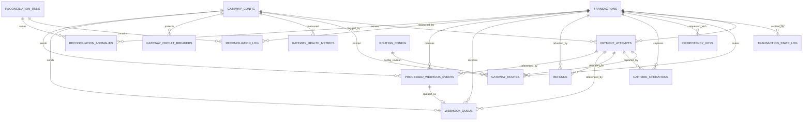

# Zetheta Payment Orchestration — Complete PostgreSQL Database Schema & Relationships

> **Scope:** ONLY **Part A — Training Material & Learning Resources**, printed PDF pages **3–23** (§A1–A8). This document is a *database implementation specification* for a coding agent. It is designed to accompany `Zetheta_Codex_Master_Implementation_Prompt.md`, not replace it.
>
> **Authority labels:** **[PDF]** = explicitly required/described by the supplied assignment; **[DESIGN]** = proposed database detail required to implement those goals safely. The PDF does **not** supply complete executable SQL for every table, so all integrated DDL below is a recommended implementation, not a verbatim reproduction. **Do not implement Parts B–F.**
>
> **Goal:** Produce correct PostgreSQL migrations, indexes, FKs, seeds, typed repositories, transactional services, and automated database/integration tests. The SQL below is a reference blueprint; adapt with a migration tool without changing its invariants.

## 1. Non-negotiable design decisions

1. **One `transactions` row per logical merchant order payment**; **one `payment_attempts` row per attempt at a gateway**. Failover creates a new attempt; never overwrite earlier provider references. [DESIGN]
2. **PostgreSQL is the source of truth** for payment state, audit history, idempotency, routing decisions, webhook durability and reconciliation. Redis may optimize but must not be the only durable store. [PDF + DESIGN]
3. Store money as **signed PostgreSQL BIGINT minor units** (`amount_minor`); monetary balances must be nonnegative, payment amount positive, and all arithmetic must be integer/decimal. No `FLOAT`, `REAL` or `DOUBLE PRECISION` for money. All flows in this assignment are best demonstrated with `INR` and 2 minor-unit decimals; do not assume this currency exponent for all international currencies. [PDF + DESIGN]
4. Financial state changes must be made in short SQL transactions with `SELECT ... FOR UPDATE`, append-only state logs and balance guards. **Never keep a DB lock open while waiting on a gateway HTTP call.** [PDF]
5. A provider timeout after dispatch means **UNKNOWN**, not FAILED. No competing gateway attempt may be dispatched until the preceding attempt is confirmed not to have a financial side effect, or there is a documented and tested provider-specific guarantee. [DESIGN]
6. Unique constraints must back idempotency, provider references, webhook deduplication and merchant order uniqueness. Application-level checks alone are insufficient. [PDF + DESIGN]
7. Do not store API keys or webhook secrets in DB config rows: store `secret_ref` identifiers and load actual secrets from a secrets manager/environment. Do not store PAN, CVV, UPI PIN or raw sensitive credentials in JSONB/logs. [DESIGN]
8. Timestamps use `TIMESTAMPTZ` (UTC in applications). Identifiers use `UUID`, except sequence-backed queue IDs; gateway reference IDs use `TEXT`/`VARCHAR` because providers define their own formats. [DESIGN]
9. Every write to payment state, gateway attempt state, refund or capture status must be audited and correlated via trace ID. **Immutable audit events are separate from mutable current-state projections.** [PDF + DESIGN]
10. Database constraints cannot encode all cross-row aggregate invariants: enforce cumulative `captured <= authorized` and `refunded + pending_refund <= captured` while locking the parent transaction, with tests proving concurrent safety. [DESIGN]

## 2. Tables, provenance, responsibilities

| Table | Provenance | Purpose | Main parent / relationship |
|---|---|---|---|
| `transactions` | **[PDF A6]** | Logical payment + current state and totals | Parent of most transaction objects |
| `transaction_state_log` | **[PDF A2/A6]** | Append-only state transitions | `transaction_id → transactions` |
| `gateway_routes` | **[PDF A6]** | Scores, chosen gateway, reasons | `transaction_id → transactions`, optional attempt |
| `idempotency_keys` | **[PDF A4/A6]** | Operation-scoped request deduplication | Optional `transaction_id` |
| `processed_webhook_events` | **[PDF A5/A6]** | `(gateway,event_id)` uniqueness | Optional transaction/attempt |
| `gateway_health_metrics` | **[PDF A3/A6]** | Per-minute performance readings | `gateway → gateway_config` |
| `reconciliation_log` | **[PDF A5/A6]** | Per-transaction reconciliation results | Run + transaction |
| `refunds` | **[PDF A6]** | Refund requests/outcomes and balances | Transaction + optional payment attempt |
| `gateway_config` | **[PDF A6]** | Capabilities, costs, rate limits, secret refs | Parent of gateway-specific rows |
| `routing_config` | **[PDF A3/A6]** | Configurable score weights + configuration revision | Global config record |
| `webhook_queue` | **[PDF A8.3]** | Durable processing + retries/DLQ | Webhook event, optional transaction |
| `payment_attempts` | **[DESIGN]** | Per-provider attempt; mandatory for safe failover | Transaction + gateway |
| `capture_operations` | **[DESIGN]** | Partial captures, retried captures, unknown outcomes | Transaction + attempt |
| `gateway_circuit_breakers` | **[DESIGN]** | Atomic breaker state per gateway and payment method | Gateway |
| `reconciliation_runs` | **[DESIGN]** | Schedule/manual run tracking | Parent of reconciliation log |
| `reconciliation_anomalies` | **[DESIGN]** | Human-investigation queue for contradictions | Transaction + optional run |

**Not included:** customer identity tables, orders/inventory, merchant credentials, KYC, bank account details or actual double-entry ledger. They are not mandated by Part A. `merchant_id` is a stable external namespace string, not a foreign key to a full merchants subsystem. Real money movement or regulatory settlement ledgers would require further design beyond this assignment.

## 3. Entity relationship diagram (Mermaid)



**ERD note:** `ROUTING_CONFIG → GATEWAY_ROUTES` is a logical version relationship (`routing_config_revision`), not a traditional FK to the sole mutable config row. This preserves the policy version used to make each decision. `PROCESSED_WEBHOOK_EVENTS → WEBHOOK_QUEUE` is implemented by `webhook_queue(gateway,event_id)` FK to the composite event key, with one queue row per event.

## 4. Executable PostgreSQL reference DDL

Target: **PostgreSQL 15+**. Execute in the displayed order inside an empty database. Use versioned **Knex migrations** in the project; do *not* run destructive SQL against an existing database. All enum-like values use `TEXT ... CHECK` to simplify forward migrations. `gen_random_uuid()` is available on supported modern PostgreSQL releases; confirm server compatibility.

### 4.1 Gateway configuration and global routing configuration

```sql
CREATE TABLE gateway_config (
    gateway_name VARCHAR(50) PRIMARY KEY,
    enabled BOOLEAN NOT NULL DEFAULT TRUE,
    environment VARCHAR(12) NOT NULL DEFAULT 'mock'
      CHECK (environment IN ('mock','sandbox','live')),
    secret_ref TEXT,                            -- Never a raw API key
    webhook_secret_ref TEXT,                    -- Never a raw secret
    supports_card BOOLEAN NOT NULL DEFAULT FALSE,
    supports_upi BOOLEAN NOT NULL DEFAULT FALSE,
    supports_netbanking BOOLEAN NOT NULL DEFAULT FALSE,
    supports_two_phase BOOLEAN NOT NULL DEFAULT FALSE,
    supports_partial_capture BOOLEAN NOT NULL DEFAULT FALSE,
    supports_partial_refund BOOLEAN NOT NULL DEFAULT FALSE,
    supported_currencies TEXT[] NOT NULL DEFAULT ARRAY['INR']::TEXT[],
    fee_bps INTEGER NOT NULL DEFAULT 0 CHECK (fee_bps >= 0),
    fee_fixed_minor BIGINT NOT NULL DEFAULT 0 CHECK (fee_fixed_minor >= 0),
    rate_limit_per_second INTEGER NOT NULL DEFAULT 100 CHECK (rate_limit_per_second > 0),
    request_timeout_ms INTEGER NOT NULL DEFAULT 30000 CHECK (request_timeout_ms > 0),
    breaker_failure_threshold INTEGER NOT NULL DEFAULT 5 CHECK (breaker_failure_threshold > 0),
    breaker_cooldown_seconds INTEGER NOT NULL DEFAULT 30 CHECK (breaker_cooldown_seconds > 0),
    breaker_half_open_max_probes INTEGER NOT NULL DEFAULT 1 CHECK (breaker_half_open_max_probes > 0),
    created_at TIMESTAMPTZ NOT NULL DEFAULT NOW(),
    updated_at TIMESTAMPTZ NOT NULL DEFAULT NOW()
);

CREATE TABLE routing_config (
    id SMALLINT PRIMARY KEY DEFAULT 1 CHECK (id = 1),
    revision BIGINT NOT NULL DEFAULT 1 CHECK (revision > 0),
    weight_success NUMERIC(6,5) NOT NULL DEFAULT 0.35000,
    weight_latency NUMERIC(6,5) NOT NULL DEFAULT 0.20000,
    weight_cost NUMERIC(6,5) NOT NULL DEFAULT 0.20000,
    weight_health NUMERIC(6,5) NOT NULL DEFAULT 0.15000,
    weight_method_fit NUMERIC(6,5) NOT NULL DEFAULT 0.10000,
    metric_window_minutes INTEGER NOT NULL DEFAULT 15 CHECK (metric_window_minutes > 0),
    degraded_preference_threshold NUMERIC(6,5) NOT NULL DEFAULT 0.20000
      CHECK (degraded_preference_threshold BETWEEN 0 AND 1),
    updated_at TIMESTAMPTZ NOT NULL DEFAULT NOW(),
    CHECK (weight_success BETWEEN 0 AND 1),
    CHECK (weight_latency BETWEEN 0 AND 1),
    CHECK (weight_cost BETWEEN 0 AND 1),
    CHECK (weight_health BETWEEN 0 AND 1),
    CHECK (weight_method_fit BETWEEN 0 AND 1),
    CHECK (weight_success + weight_latency + weight_cost + weight_health + weight_method_fit = 1.00000)
);
```

**Notes:** Fees in basis points are exact integers: `2.0% = 200 bps`; fixed fee ₹2.00 = `200` minor units. Compute percentage fees with integer arithmetic and explicitly defined rounding. `supported_currencies` and method flags are *configured simulated capabilities*, not promises of real provider support. Revision increments under a row lock whenever routing configuration changes.

### 4.2 Logical transactions and individual gateway attempts

```sql
CREATE TABLE transactions (
    id UUID PRIMARY KEY DEFAULT gen_random_uuid(),
    merchant_id VARCHAR(100) NOT NULL,
    merchant_order_id VARCHAR(255) NOT NULL,
    payment_method VARCHAR(24) NOT NULL
      CHECK (payment_method IN ('CARD','UPI','NETBANKING')),
    currency VARCHAR(3) NOT NULL DEFAULT 'INR',
    amount_minor BIGINT NOT NULL CHECK (amount_minor > 0),
    capture_mode VARCHAR(16) NOT NULL DEFAULT 'MANUAL'
      CHECK (capture_mode IN ('MANUAL','AUTOMATIC')),
    state VARCHAR(32) NOT NULL DEFAULT 'CREATED'
      CHECK (state IN (
        'CREATED','ROUTE_SELECTED','AUTH_INITIATED','AUTHORISED','AUTH_FAILED',
        'AUTH_TIMEOUT','ROUTE_FAILED','CAPTURE_INITIATED','CAPTURED',
        'PARTIALLY_CAPTURED','CAPTURE_FAILED','REFUND_INITIATED',
        'PARTIALLY_REFUNDED','REFUND_FAILED','REFUNDED','FAILED',
        'ABANDONED','VOID_INITIATED','VOIDED','AUTH_EXPIRED',
        'SETTLED','DISPUTE_OPENED','DISPUTE_RESOLVED'
      )),
    authorized_minor BIGINT NOT NULL DEFAULT 0 CHECK (authorized_minor >= 0),
    captured_minor BIGINT NOT NULL DEFAULT 0 CHECK (captured_minor >= 0),
    refunded_minor BIGINT NOT NULL DEFAULT 0 CHECK (refunded_minor >= 0),
    reserved_refund_minor BIGINT NOT NULL DEFAULT 0 CHECK (reserved_refund_minor >= 0),
    version BIGINT NOT NULL DEFAULT 0 CHECK (version >= 0),
    trace_id UUID NOT NULL,
    last_error_code VARCHAR(100),
    metadata JSONB NOT NULL DEFAULT '{}'::JSONB,
    created_at TIMESTAMPTZ NOT NULL DEFAULT NOW(),
    updated_at TIMESTAMPTZ NOT NULL DEFAULT NOW(),
    UNIQUE (merchant_id, merchant_order_id),
    CHECK (authorized_minor <= amount_minor),
    CHECK (captured_minor <= authorized_minor),
    CHECK (refunded_minor + reserved_refund_minor <= captured_minor)
);

CREATE TABLE payment_attempts (
    id UUID PRIMARY KEY DEFAULT gen_random_uuid(),
    transaction_id UUID NOT NULL REFERENCES transactions(id) ON DELETE RESTRICT,
    gateway VARCHAR(50) NOT NULL REFERENCES gateway_config(gateway_name),
    attempt_no INTEGER NOT NULL CHECK (attempt_no > 0),
    status VARCHAR(20) NOT NULL DEFAULT 'CREATED'
      CHECK (status IN ('CREATED','SENT','UNKNOWN','AUTHORISED','CAPTURED','FAILED','VOIDED')),
    provider_payment_ref VARCHAR(255),
    provider_order_ref VARCHAR(255),
    provider_idempotency_key VARCHAR(255),
    amount_minor BIGINT NOT NULL CHECK (amount_minor > 0),
    request_dispatched_at TIMESTAMPTZ,
    resolved_at TIMESTAMPTZ,
    error_class VARCHAR(40),
    error_code VARCHAR(100),
    trace_id UUID NOT NULL,
    created_at TIMESTAMPTZ NOT NULL DEFAULT NOW(),
    updated_at TIMESTAMPTZ NOT NULL DEFAULT NOW(),
    UNIQUE (transaction_id, attempt_no),
    UNIQUE (id, transaction_id),
    UNIQUE (gateway, provider_payment_ref),
    UNIQUE (gateway, provider_order_ref),
    UNIQUE (gateway, provider_idempotency_key)
);

-- Prevent two concurrently unresolved authorisation attempts for one logical payment.
CREATE UNIQUE INDEX uq_payment_attempts_one_active
  ON payment_attempts(transaction_id)
  WHERE status IN ('CREATED','SENT','UNKNOWN','AUTHORISED');

CREATE INDEX idx_transactions_state_created ON transactions(state, created_at);
CREATE INDEX idx_transactions_created_at ON transactions(created_at);
CREATE INDEX idx_transactions_trace_id ON transactions(trace_id);
CREATE INDEX idx_payment_attempts_tx_created ON payment_attempts(transaction_id, created_at);
CREATE INDEX idx_payment_attempts_gateway_status ON payment_attempts(gateway, status);
```

**Important partial-index caveat:** `AUTHORISED` is active until explicitly resolved (captured/voided/expired); for a manual capture, this ensures no second authorization attempt is sent. Capture failures must not automatically clear the attempt. `CAPTURED` may be terminal *for authorisation attempt selection* while capture/refund operations continue on it. If a late callback arrives for a prior attempt, correlate by provider reference; do not overwrite the parent based solely on arrival order.

**Relationship assertion:** For every linked operation, make `transaction_id` match the referenced attempt's transaction using a **composite FK** where provided below. This prevents cross-transaction references.

### 4.3 Routing decisions, circuit breakers and health metrics

```sql
CREATE TABLE gateway_routes (
    id UUID PRIMARY KEY DEFAULT gen_random_uuid(),
    transaction_id UUID NOT NULL REFERENCES transactions(id) ON DELETE RESTRICT,
    attempt_id UUID,
    gateway VARCHAR(50) NOT NULL REFERENCES gateway_config(gateway_name),
    routing_config_revision BIGINT NOT NULL CHECK (routing_config_revision > 0),
    selected BOOLEAN NOT NULL DEFAULT FALSE,
    score NUMERIC(10,8) NOT NULL CHECK (score BETWEEN 0 AND 1),
    normalized_success NUMERIC(10,8) NOT NULL CHECK (normalized_success BETWEEN 0 AND 1),
    normalized_latency NUMERIC(10,8) NOT NULL CHECK (normalized_latency BETWEEN 0 AND 1),
    normalized_cost NUMERIC(10,8) NOT NULL CHECK (normalized_cost BETWEEN 0 AND 1),
    health_score NUMERIC(10,8) NOT NULL CHECK (health_score BETWEEN 0 AND 1),
    method_fit_score NUMERIC(10,8) NOT NULL CHECK (method_fit_score BETWEEN 0 AND 1),
    reason JSONB NOT NULL DEFAULT '{}'::JSONB,
    trace_id UUID NOT NULL,
    created_at TIMESTAMPTZ NOT NULL DEFAULT NOW(),
    FOREIGN KEY (attempt_id, transaction_id)
      REFERENCES payment_attempts(id, transaction_id) ON DELETE RESTRICT
);
CREATE INDEX idx_gateway_routes_tx_created ON gateway_routes(transaction_id, created_at);
CREATE INDEX idx_gateway_routes_gateway_score ON gateway_routes(gateway, score DESC);
CREATE UNIQUE INDEX uq_gateway_routes_one_selected_per_attempt
  ON gateway_routes(attempt_id) WHERE selected = TRUE AND attempt_id IS NOT NULL;

CREATE TABLE gateway_circuit_breakers (
    gateway VARCHAR(50) NOT NULL REFERENCES gateway_config(gateway_name),
    payment_method VARCHAR(24) NOT NULL CHECK (payment_method IN ('CARD','UPI','NETBANKING')),
    state VARCHAR(12) NOT NULL DEFAULT 'CLOSED'
      CHECK (state IN ('CLOSED','OPEN','HALF_OPEN')),
    consecutive_failures INTEGER NOT NULL DEFAULT 0 CHECK (consecutive_failures >= 0),
    opened_until TIMESTAMPTZ,
    probe_lease_until TIMESTAMPTZ,
    probe_owner UUID,
    updated_at TIMESTAMPTZ NOT NULL DEFAULT NOW(),
    PRIMARY KEY (gateway, payment_method)
);

CREATE TABLE gateway_health_metrics (
    id BIGINT GENERATED ALWAYS AS IDENTITY PRIMARY KEY,
    gateway VARCHAR(50) NOT NULL REFERENCES gateway_config(gateway_name),
    payment_method VARCHAR(24) NOT NULL CHECK (payment_method IN ('CARD','UPI','NETBANKING')),
    window_start TIMESTAMPTZ NOT NULL,
    recorded_at TIMESTAMPTZ NOT NULL DEFAULT NOW(),
    total_count BIGINT NOT NULL DEFAULT 0 CHECK (total_count >= 0),
    success_count BIGINT NOT NULL DEFAULT 0 CHECK (success_count >= 0),
    p95_latency_ms INTEGER CHECK (p95_latency_ms >= 0),
    error_count BIGINT NOT NULL DEFAULT 0 CHECK (error_count >= 0),
    CHECK (success_count <= total_count),
    CHECK (error_count <= total_count),
    UNIQUE (gateway, payment_method, window_start)
);
CREATE INDEX idx_gateway_health_gateway_recorded
  ON gateway_health_metrics(gateway, payment_method, recorded_at DESC);
```

`gateway_routes` records **all candidates** considered, not only the winner. `selected=TRUE` records the winner for one attempt; optionally record rejected candidates as rows with `attempt_id=NULL`. The scoring inputs are persisted to explain historical decisions even after config/metrics change.

### 4.4 Immutable transaction-state audit log

```sql
CREATE TABLE transaction_state_log (
    id UUID PRIMARY KEY DEFAULT gen_random_uuid(),
    transaction_id UUID NOT NULL REFERENCES transactions(id) ON DELETE RESTRICT,
    attempt_id UUID,
    from_state VARCHAR(32),
    to_state VARCHAR(32) NOT NULL,
    event VARCHAR(100) NOT NULL,
    gateway_reference VARCHAR(255),
    gateway_response JSONB NOT NULL DEFAULT '{}'::JSONB,
    metadata JSONB NOT NULL DEFAULT '{}'::JSONB,
    trace_id UUID NOT NULL,
    created_at TIMESTAMPTZ NOT NULL DEFAULT NOW(),
    created_by VARCHAR(100) NOT NULL,
    FOREIGN KEY (attempt_id, transaction_id)
      REFERENCES payment_attempts(id, transaction_id) ON DELETE RESTRICT
);
CREATE INDEX idx_state_log_tx_created ON transaction_state_log(transaction_id, created_at, id);
CREATE INDEX idx_state_log_transition ON transaction_state_log(from_state, to_state);
CREATE INDEX idx_state_log_trace ON transaction_state_log(trace_id);

CREATE FUNCTION forbid_audit_mutation() RETURNS trigger LANGUAGE plpgsql AS $$
BEGIN
  RAISE EXCEPTION 'transaction_state_log is append-only';
END;
$$;
CREATE TRIGGER trg_state_log_immutable
  BEFORE UPDATE OR DELETE ON transaction_state_log
  FOR EACH ROW EXECUTE FUNCTION forbid_audit_mutation();
```

Always write `(state update + audit insert)` in **the same** DB transaction. For `CREATED`, insert an initial log with `from_state=NULL`. Add application-level transition validation; SQL values alone cannot ensure legal edges. Never include full unsanitized provider responses.

### 4.5 Merchant idempotency keys (request deduplication)

```sql
CREATE TABLE idempotency_keys (
    merchant_id VARCHAR(100) NOT NULL,
    operation VARCHAR(40) NOT NULL
      CHECK (operation IN ('PAYMENT_CREATE','CAPTURE','VOID','REFUND')),
    key VARCHAR(255) NOT NULL,
    request_hash VARCHAR(64) NOT NULL CHECK (request_hash ~ '^[0-9a-f]{64}$'),
    transaction_id UUID REFERENCES transactions(id) ON DELETE RESTRICT,
    status VARCHAR(20) NOT NULL DEFAULT 'PROCESSING'
      CHECK (status IN ('PROCESSING','COMPLETED','FAILED','UNKNOWN')),
    response_code INTEGER CHECK (response_code BETWEEN 100 AND 599),
    response_body JSONB,
    created_at TIMESTAMPTZ NOT NULL DEFAULT NOW(),
    updated_at TIMESTAMPTZ NOT NULL DEFAULT NOW(),
    expires_at TIMESTAMPTZ NOT NULL DEFAULT (NOW() + INTERVAL '24 hours'),
    PRIMARY KEY (merchant_id, operation, key)
);
CREATE INDEX idx_idempotency_expiry ON idempotency_keys(expires_at);
CREATE INDEX idx_idempotency_transaction ON idempotency_keys(transaction_id);
```

**PDF divergence:** `UNKNOWN` is a **[DESIGN]** addition to the PDF's `PROCESSING|COMPLETED|FAILED`. It prevents a timed-out-but-possibly-executed provider call from being retried as if no side effect occurred. A repeat key with a different canonical request hash must return a conflict, even if a result is cached. Keep keys for at least the documented replay window; never remove the only record that protects an unresolved external operation.

`transaction_id` can remain `NULL` while processing initial payment creation, but the first transaction row and idempotency claim must be committed together before dispatching an external call. For capture/refund/void, associate the existing transaction before dispatch.

### 4.6 Capture operations and refunds

```sql
CREATE TABLE capture_operations (
    id UUID PRIMARY KEY DEFAULT gen_random_uuid(),
    transaction_id UUID NOT NULL REFERENCES transactions(id) ON DELETE RESTRICT,
    attempt_id UUID NOT NULL,
    operation_key VARCHAR(255) NOT NULL,
    amount_minor BIGINT NOT NULL CHECK (amount_minor > 0),
    status VARCHAR(24) NOT NULL DEFAULT 'PENDING'
      CHECK (status IN ('PENDING','SENT','UNKNOWN','SUCCEEDED','FAILED')),
    provider_capture_ref VARCHAR(255),
    trace_id UUID NOT NULL,
    created_at TIMESTAMPTZ NOT NULL DEFAULT NOW(),
    updated_at TIMESTAMPTZ NOT NULL DEFAULT NOW(),
    FOREIGN KEY (attempt_id, transaction_id)
      REFERENCES payment_attempts(id, transaction_id) ON DELETE RESTRICT,
    UNIQUE (transaction_id, operation_key)
);
CREATE UNIQUE INDEX uq_capture_provider_ref
  ON capture_operations(attempt_id, provider_capture_ref)
  WHERE provider_capture_ref IS NOT NULL;
CREATE INDEX idx_capture_tx_status ON capture_operations(transaction_id, status);

CREATE TABLE refunds (
    id UUID PRIMARY KEY DEFAULT gen_random_uuid(),
    transaction_id UUID NOT NULL REFERENCES transactions(id) ON DELETE RESTRICT,
    attempt_id UUID NOT NULL,
    operation_key VARCHAR(255) NOT NULL,
    amount_minor BIGINT NOT NULL CHECK (amount_minor > 0),
    currency VARCHAR(3) NOT NULL DEFAULT 'INR',
    status VARCHAR(24) NOT NULL DEFAULT 'PENDING'
      CHECK (status IN ('PENDING','SENT','UNKNOWN','SUCCEEDED','FAILED')),
    gateway_refund_id VARCHAR(255),
    reason VARCHAR(255),
    trace_id UUID NOT NULL,
    created_at TIMESTAMPTZ NOT NULL DEFAULT NOW(),
    updated_at TIMESTAMPTZ NOT NULL DEFAULT NOW(),
    FOREIGN KEY (attempt_id, transaction_id)
      REFERENCES payment_attempts(id, transaction_id) ON DELETE RESTRICT,
    UNIQUE (transaction_id, operation_key)
);
CREATE UNIQUE INDEX uq_refunds_provider_ref
  ON refunds(attempt_id, gateway_refund_id)
  WHERE gateway_refund_id IS NOT NULL;
CREATE INDEX idx_refunds_tx_status ON refunds(transaction_id, status);
```

**Accounting algorithm:** Under a `transactions FOR UPDATE` lock, reserve refund money: `reserved_refund_minor += requested`; reject if `refunded_minor + reserved_refund_minor + requested > captured_minor`. Commit before the provider call. After verified refund success, atomically move the amount from reserved to refunded; after a **definite** failure, release the reservation; after unknown outcome, keep it reserved until reconciliation resolves the original operation. Never treat an HTTP timeout as definitive failure. `capture_operations` works similarly: authorization/capture capacity must include both successful and pending/unknown captures to prevent over-capture. A second capture request must not exceed remaining authorized capacity, respecting gateway capability for partial/multiple captures.

### 4.7 Webhook deduplication and durable processing queue

```sql
CREATE TABLE processed_webhook_events (
    gateway VARCHAR(50) NOT NULL REFERENCES gateway_config(gateway_name),
    event_id VARCHAR(255) NOT NULL,
    event_type VARCHAR(100) NOT NULL,
    payload_hash VARCHAR(64) NOT NULL CHECK (payload_hash ~ '^[0-9a-f]{64}$'),
    transaction_id UUID REFERENCES transactions(id) ON DELETE RESTRICT,
    attempt_id UUID,
    status VARCHAR(16) NOT NULL DEFAULT 'RECEIVED'
      CHECK (status IN ('RECEIVED','PROCESSED','DLQ')),
    received_at TIMESTAMPTZ NOT NULL DEFAULT NOW(),
    processed_at TIMESTAMPTZ,
    PRIMARY KEY (gateway, event_id),
    FOREIGN KEY (attempt_id, transaction_id)
      REFERENCES payment_attempts(id, transaction_id) ON DELETE RESTRICT
);
CREATE INDEX idx_webhook_events_transaction ON processed_webhook_events(transaction_id);

CREATE TABLE webhook_queue (
    id BIGINT GENERATED ALWAYS AS IDENTITY PRIMARY KEY,
    gateway VARCHAR(50) NOT NULL,
    event_id VARCHAR(255) NOT NULL,
    transaction_id UUID REFERENCES transactions(id) ON DELETE RESTRICT,
    attempt_id UUID,
    payload JSONB NOT NULL,                    -- verified, redacted necessary fields only
    signature_digest VARCHAR(64),              -- optional hash, not raw signature
    status VARCHAR(20) NOT NULL DEFAULT 'PENDING'
      CHECK (status IN ('PENDING','PROCESSING','COMPLETED','FAILED','DLQ')),
    retry_count INTEGER NOT NULL DEFAULT 0 CHECK (retry_count >= 0),
    max_retries INTEGER NOT NULL DEFAULT 3 CHECK (max_retries >= 0),
    next_retry_at TIMESTAMPTZ NOT NULL DEFAULT NOW(),
    lease_owner UUID,
    lease_expires_at TIMESTAMPTZ,
    error_message TEXT,
    trace_id UUID,
    created_at TIMESTAMPTZ NOT NULL DEFAULT NOW(),
    processed_at TIMESTAMPTZ,
    FOREIGN KEY (gateway, event_id)
      REFERENCES processed_webhook_events(gateway, event_id) ON DELETE RESTRICT,
    FOREIGN KEY (attempt_id, transaction_id)
      REFERENCES payment_attempts(id, transaction_id) ON DELETE RESTRICT,
    UNIQUE (gateway, event_id)
);
CREATE INDEX idx_webhook_queue_ready ON webhook_queue(next_retry_at, id)
  WHERE status IN ('PENDING','FAILED');
CREATE INDEX idx_webhook_queue_expired_lease ON webhook_queue(lease_expires_at)
  WHERE status = 'PROCESSING';
CREATE INDEX idx_webhook_queue_dlq ON webhook_queue(created_at)
  WHERE status = 'DLQ';
```

**Critical atomicity:** After signature verification against the raw HTTP bytes, in one SQL transaction insert the `processed_webhook_events` receipt (`ON CONFLICT DO NOTHING`) **and** its corresponding `webhook_queue` row, then commit. Duplicate verified events: return HTTP 200 and do not enqueue again. If the DB transaction fails, return non-2xx so the provider can retry. **Do not mark `PROCESSED` until worker processing and all state/audit updates commit.**

**Workers:** `SELECT ... FOR UPDATE SKIP LOCKED` claims ready items, sets `PROCESSING` plus a lease and commits. Process state transitions in a new short transaction. On success set both event status `PROCESSED` and queue `COMPLETED` in the same transaction. On retryable failure increase count and apply exponential backoff; after max attempts transition both to DLQ. Expired leases must be reclaimable. Admin replay only after authorized action and root-cause resolution; never delete original event IDs.

**Raw signatures:** The PDF example shows a `signature TEXT` column. This proposed schema instead keeps a digest and verifies signatures on the **original raw request bytes at HTTP ingress**; do not try to verify provider signatures by re-serializing the stored JSON. If a provider requires exact-body replay, store the original raw bytes encrypted with retention controls, and define a secure replay policy rather than storing unprotected raw payloads.

### 4.8 Reconciliation runs, per-payment results and anomalies

```sql
CREATE TABLE reconciliation_runs (
    id UUID PRIMARY KEY DEFAULT gen_random_uuid(),
    trigger_source VARCHAR(16) NOT NULL CHECK (trigger_source IN ('SCHEDULED','MANUAL')),
    status VARCHAR(16) NOT NULL DEFAULT 'RUNNING'
      CHECK (status IN ('RUNNING','COMPLETED','FAILED')),
    scanned_count INTEGER NOT NULL DEFAULT 0 CHECK (scanned_count >= 0),
    mismatch_count INTEGER NOT NULL DEFAULT 0 CHECK (mismatch_count >= 0),
    started_at TIMESTAMPTZ NOT NULL DEFAULT NOW(),
    completed_at TIMESTAMPTZ,
    trace_id UUID NOT NULL
);

CREATE TABLE reconciliation_log (
    id UUID PRIMARY KEY DEFAULT gen_random_uuid(),
    run_id UUID NOT NULL REFERENCES reconciliation_runs(id) ON DELETE RESTRICT,
    transaction_id UUID NOT NULL REFERENCES transactions(id) ON DELETE RESTRICT,
    attempt_id UUID,
    gateway VARCHAR(50) NOT NULL REFERENCES gateway_config(gateway_name),
    internal_state VARCHAR(32) NOT NULL,
    provider_state VARCHAR(100),
    discrepancy_type VARCHAR(100),
    action VARCHAR(100) NOT NULL,
    outcome VARCHAR(20) NOT NULL CHECK (outcome IN ('MATCH','CORRECTED','ANOMALY','ERROR')),
    details JSONB NOT NULL DEFAULT '{}'::JSONB,
    trace_id UUID NOT NULL,
    created_at TIMESTAMPTZ NOT NULL DEFAULT NOW(),
    FOREIGN KEY (attempt_id, transaction_id)
      REFERENCES payment_attempts(id, transaction_id) ON DELETE RESTRICT
);
CREATE INDEX idx_reconciliation_log_run ON reconciliation_log(run_id, created_at);
CREATE INDEX idx_reconciliation_log_tx ON reconciliation_log(transaction_id, created_at DESC);

CREATE TABLE reconciliation_anomalies (
    id UUID PRIMARY KEY DEFAULT gen_random_uuid(),
    run_id UUID REFERENCES reconciliation_runs(id) ON DELETE RESTRICT,
    transaction_id UUID NOT NULL REFERENCES transactions(id) ON DELETE RESTRICT,
    reconciliation_log_id UUID REFERENCES reconciliation_log(id) ON DELETE RESTRICT,
    severity VARCHAR(12) NOT NULL CHECK (severity IN ('LOW','MEDIUM','HIGH','CRITICAL')),
    status VARCHAR(20) NOT NULL DEFAULT 'OPEN'
      CHECK (status IN ('OPEN','INVESTIGATING','RESOLVED')),
    anomaly_type VARCHAR(100) NOT NULL,
    description TEXT NOT NULL,
    trace_id UUID NOT NULL,
    created_at TIMESTAMPTZ NOT NULL DEFAULT NOW(),
    resolved_at TIMESTAMPTZ
);
CREATE INDEX idx_reconciliation_anomalies_open ON reconciliation_anomalies(severity, created_at)
  WHERE status != 'RESOLVED';
```

Reconciliation should run on a configurable schedule (PDF suggests every **15 minutes**); identify records stuck in `AUTH_INITIATED` or `CAPTURE_INITIATED` beyond a configurable threshold (PDF example **5 minutes**), plus unresolved attempt/capture/refund states. Poll by the **specific attempt provider reference**, not just a mutable gateway field on the transaction. Only safe and verified reconciliation outcomes produce state transitions; contradictory information such as internal `CAPTURED` vs provider `FAILED` must create a critical anomaly instead of silently rewriting financial history.

## 5. Explicit foreign-key and cardinality map

| Child / column(s) | Parent key | Cardinality | Delete rule | Notes |
|---|---|---|---|---|
| `payment_attempts.transaction_id` | `transactions.id` | 1 transaction : N attempts | RESTRICT | Critical failover model |
| `payment_attempts.gateway` | `gateway_config.gateway_name` | 1 gateway : N attempts | default NO ACTION | Provider reference scoped by gateway |
| `transaction_state_log.transaction_id` | `transactions.id` | 1 : N | RESTRICT | Append-only |
| `transaction_state_log.(attempt_id,transaction_id)` | `payment_attempts.(id,transaction_id)` | optional attempt : N logs | RESTRICT | Validates ownership |
| `gateway_routes.transaction_id` | `transactions.id` | 1 : N | RESTRICT | All scores/decisions |
| `gateway_routes.(attempt_id,transaction_id)` | `payment_attempts.(id,transaction_id)` | optional attempt : N | RESTRICT | Selected attempt association |
| `gateway_routes.gateway` | `gateway_config.gateway_name` | 1 : N | default NO ACTION | Candidate gateway |
| `idempotency_keys.transaction_id` | `transactions.id` | 1 : N request keys | RESTRICT | Nullable before initial transaction creation |
| `capture_operations.(attempt_id,transaction_id)` | `payment_attempts.(id,transaction_id)` | 1 attempt : N captures | RESTRICT | Cross-payment reference blocked |
| `refunds.(attempt_id,transaction_id)` | `payment_attempts.(id,transaction_id)` | 1 attempt : N refunds | RESTRICT | Cross-payment reference blocked |
| `processed_webhook_events.(attempt_id,transaction_id)` | `payment_attempts.(id,transaction_id)` | optional attempt : N events | RESTRICT | Can be unresolved at initial receipt |
| `webhook_queue.(gateway,event_id)` | `processed_webhook_events.(gateway,event_id)` | 1 event : 0 or 1 queue item | RESTRICT | Unique event in queue |
| `webhook_queue.(attempt_id,transaction_id)` | `payment_attempts.(id,transaction_id)` | optional attempt : N queued items | RESTRICT | Resolved after matching |
| `gateway_health_metrics.gateway` | `gateway_config.gateway_name` | 1 : N | default NO ACTION | Time-window aggregates |
| `gateway_circuit_breakers.gateway` | `gateway_config.gateway_name` | 1 : N methods | default NO ACTION | PK includes method |
| `reconciliation_log.run_id` | `reconciliation_runs.id` | 1 : N | RESTRICT | Batch output |
| `reconciliation_log.transaction_id` | `transactions.id` | 1 : N | RESTRICT | Auditable result |
| `reconciliation_anomalies.transaction_id` | `transactions.id` | 1 : N | RESTRICT | Unresolved discrepancies |
| `reconciliation_anomalies.reconciliation_log_id` | `reconciliation_log.id` | optional log : N anomalies | RESTRICT | Root record |

`gateway_config` and `routing_config` are configuration tables, not payment data stores. `gateway_health_metrics` holds observations; `gateway_circuit_breakers` holds real-time protection decisions. **Do not create multiple separate PostgreSQL databases** for these modules; the task needs **multiple related tables inside one transactional PostgreSQL database**. PostgreSQL schemas such as `public` are namespaces; all tables may reside in `public` for the 15-day project.

## 6. Transaction and locking contracts (mandatory)

### 6.1 Payment creation + idempotency

1. Verify API merchant context and canonicalize request payload; hash it with SHA-256.
2. `BEGIN`; claim `(merchant_id,'PAYMENT_CREATE',idempotency_key)` using insert and unique constraint; compare hash if existing. A still-running request returns `409`/consistent documented response, completed returns stored result.
3. Inside the same transaction insert `transactions(state='CREATED')`, initial `transaction_state_log` and attach `idempotency_keys.transaction_id`; `COMMIT` **before** gateway HTTP call.
4. In short DB transactions select/configure an eligible gateway; persist route(s), create `payment_attempts`, set intermediate transaction state and append log. Do not hold DB transaction open across HTTP dispatch.
5. Send provider request with stable provider idempotency identifier where supported. If response is definite success/failure, persist it in a transaction. If outcome is ambiguous, persist `UNKNOWN` and trigger status resolution.
6. Cache stable HTTP response for completed merchant idempotency key. Avoid reissuing a provider call upon replay; use original attempt reference/status.

**Nuance:** A logical transaction's `merchant_order_id` unique constraint is an additional anti-duplication layer. A fresh `Idempotency-Key` must **not** create a second logical transaction for the same `(merchant_id, merchant_order_id)` unless the product explicitly models multiple payment intents and changes this key strategy with tests.

### 6.2 Safe gateway failover

- `FAILED` is safe to reroute only for provider-confirmed non-execution/temporary failure. Hard declines (insufficient funds/fraud decline) are not automatically rerouted.
- `UNKNOWN` and pending prior authorization block a fresh authorization attempt. Resolve via provider status lookup, webhook, or reconciliation.
- Keep old `payment_attempts` rows and `gateway_routes` entries forever per retention policy; do not update old references to point to new gateways.
- Insert a new attempt only after prior attempt becomes conclusively non-executing/failed/voided, subject to policy. Use unique active-attempt index and transactional state checks to enforce this.
- Meet the PDF's **<2-second failover objective** only for eligible failures where safety can be established within that time. Never compromise no-double-charge guarantees for latency.

### 6.3 Authorize/capture/void

- In DB transaction lock parent `transactions`, validate FSM transition, create provider operation record or update attempt status, reserve capacity, log and commit. Then call provider.
- For multiple partial captures, compute `captured_minor + SUM(capture_operations.amount_minor WHERE status IN ('PENDING','SENT','UNKNOWN')) + requested <= authorized_minor` **using a consistent accounting strategy**; do not double-count pending captures. A SQL CHECK cannot span rows.
- On provider success, under lock move reserved amount into `captured_minor` and write audit. On unknown preserve reserved capacity. On definite failure release it.
- Void only confirmed uncaptured authorisation subject to provider capability. Never void a captured payment; use refund flow instead.
- `AUTHORIZED` (document spelling: `AUTHORISED`) and `CAPTURED` are distinct lifecycle events. `SETTLED` is not the same as `CAPTURED`.

### 6.4 Refund

- Lock parent transaction; require successfully captured funds and provider refund capability. Create refund record plus idempotency claim in the same transaction, increment `reserved_refund_minor`, log and commit.
- Provider call outside DB transaction. On success, decrement reserved and increment refunded; on definite failure decrement reserved only; on unknown keep reserved and reconcile later.
- Sum all successful refunds plus pending/unknown reserved refunds must **never exceed captured amount**.
- Parent aggregate FSM state must not misrepresent a mixed state (e.g. partial refund while another refund pending): rely on individual refund state and calculate derived summary where needed.

### 6.5 Webhooks and reconciliation

- Validate real provider signature from raw bytes. For mocks, document exact HMAC scheme and test invalid/replayed events.
- Insert receipt + queue atomically; return 2xx only after persistence. Dedupe by `(gateway,event_id)`.
- Workers correlate via `(gateway,provider_payment_ref)` and `payment_attempts`; use transaction row locking and version/transition guards; delayed webhook must not regress a settled/fully refunded payment.
- Reconciliation resolves provider truth but must retain immutable internal history and explicit corrective events. Unexpected contradictions create anomaly records.

## 7. Mandatory seed data

### 7.1 Initial routing configuration

```sql
INSERT INTO routing_config
 (id,revision,weight_success,weight_latency,weight_cost,weight_health,weight_method_fit)
VALUES (1,1,0.35,0.20,0.20,0.15,0.10)
ON CONFLICT (id) DO NOTHING;
```

### 7.2 Gateway mock configurations

PDF A3 gives these example fee/latency series, not universally valid live contract prices. Seed fee examples for *mock simulations*:

| Gateway | Fee rate | Fixed fee | fee_bps | fee_fixed_minor (INR) |
|---|---:|---:|---:|---:|
| Razorpay | 2.0% | ₹2 | 200 | 200 |
| Stripe | 2.5% | ₹3 | 250 | 300 |
| PayU | 1.8% | ₹1.50 | 180 | 150 |
| UPI | 0.0% | ₹0 | 0 | 0 |

Create `gateway_config` rows with `environment='mock'` and conservative **explicit capabilities** according to the mock adapter support. Do not infer live provider capabilities from the PDF's simplified table. Seed breaker configuration 5 failures/30 seconds/1 probe for every supported `(gateway,payment_method)` pair. The PDF gives example rate limits, but do not assume they are current or guaranteed live limits.

### 7.3 Historical performance fixture, PDF page 10

Store these as **seed fixture data**. Because the page groups data by time-of-day rather than actual dates, define a reproducible synthetic fixture date in test data, and explain that the date is invented for testing, not present in the PDF. Prefer importing this table from a fixture CSV into `gateway_health_metrics` with a documented mapping of `hour band → window_start`; for a 6-hour historical band, do **not** pretend the sample is a true per-minute sliding-window measurement.

| Gateway | Time band | Success % | P95 ms | Txns |
|---|---|---:|---:|---:|
| Razorpay | 00:00–06:00 | 98.5 | 320 | 4,200 |
| Razorpay | 06:00–12:00 | 97.2 | 450 | 18,500 |
| Razorpay | 12:00–18:00 | 94.1 | 780 | 32,000 |
| Razorpay | 18:00–24:00 | 96.8 | 520 | 25,300 |
| Stripe | 00:00–06:00 | 99.1 | 280 | 3,800 |
| Stripe | 06:00–12:00 | 98.8 | 310 | 15,200 |
| Stripe | 12:00–18:00 | 97.5 | 420 | 28,500 |
| Stripe | 18:00–24:00 | 98.2 | 350 | 22,100 |
| PayU | 00:00–06:00 | 96.0 | 400 | 2,100 |
| PayU | 06:00–12:00 | 93.5 | 620 | 9,800 |
| PayU | 12:00–18:00 | 89.2 | 950 | 15,500 |
| PayU | 18:00–24:00 | 91.8 | 750 | 12,200 |
| UPI | 00:00–06:00 | 99.5 | 180 | 5,600 |
| UPI | 06:00–12:00 | 99.2 | 210 | 22,000 |
| UPI | 12:00–18:00 | 98.0 | 350 | 38,000 |
| UPI | 18:00–24:00 | 98.8 | 250 | 30,500 |

If historical success rate × transaction count does not produce an integer, do not silently round it as if measured: either preserve the published percentage in a separate dedicated **fixture** table, or clearly flag simulated integer counts. For true realtime metrics aggregate actual attempt outcomes.

## 8. Migration and repository instructions for Codex

1. Read this file and the master implementation prompt. Check repository for existing migrations and reconcile differences; **do not blindly create duplicate tables**.
2. Implement migration order: `(1) gateway_config/routing_config → (2) transactions/payment_attempts → (3) gateway_routes/breakers/metrics → (4) state log/idempotency → (5) captures/refunds → (6) webhook receipt/queue → (7) reconciliation tables → (8) indexes/triggers/seeds`.
3. Implement explicit Knex migrations using UUIDs, `bigint`, `numeric`, JSONB, FK constraints, `CHECK` constraints and partial unique indexes; where Knex abstractions are weaker, use `knex.raw(sql)`.
4. Implement repositories and transaction-bound APIs, including `withTransaction(...)`, `lockTransactionForUpdate(id)`, atomic state transition, idempotency claim/result resolution, webhook enqueue/claim/complete, capture/refund reservations, route persistence and reconciliation record writes.
5. Use `pg` bigint decoding carefully: PostgreSQL `BIGINT` commonly arrives as a **string** in Node.js; parse with `BigInt`, return JSON amounts as decimal strings or validated safe numbers only according to the public API contract. Never serialize JS `BigInt` directly as JSON.
6. Any migrations which remove tables or drop columns must only run in disposable local/test databases with explicit confirmation. Maintain reversible migrations where safe.
7. Use distinct test database credentials; avoid tests or seed scripts pointing at production. Provide `.env.example`, `npm run db:migrate`, `npm run db:rollback`, `npm run db:seed`, and `npm run test:integration`.
8. Include a concise `docs/database-architecture.md` that reproduces the ER diagram, table responsibilities, read/write flows, and explicit `[PDF]` vs `[DESIGN]` decisions.
9. Expose current connections through database repositories/services; do not use raw query strings directly from HTTP controllers.
10. **Execute migrations and database tests**; report exact results and unresolved external API limitations. Do not claim correctness without executing them.

## 9. Database integration and concurrency tests (acceptance gate)

For each test, assert **SQL persisted state + gateway mock side-effect count**, not only HTTP status:

1. Schema migrates from empty DB, reruns safe migrations without damaging data, and rolls back in disposable DB.
2. Every FK rejects a non-existent parent; composite FKs reject attempt IDs from another transaction.
3. `merchant_id + merchant_order_id` is unique, but same order ID allowed for another merchant.
4. Payment amount must be positive, all monetary balances nonnegative, and captured/refunded constraints hold.
5. Gateway provider references are unique **within gateway** but may be reused by different gateways.
6. Two concurrent identical payment API calls create one logical payment and at most one dispatched provider authorization.
7. Same idempotency key with different request body rejects safely.
8. A timed-out-after-execution provider attempt is `UNKNOWN`, cannot trigger new gateway attempt, and resolves to the correct original provider charge.
9. A definitive gateway non-execution failure permits a new attempt, while old references remain queryable.
10. Concurrent route choices cannot create two active unresolved attempts for one transaction.
11. Invalid state transition fails and makes **no state or audit change**.
12. Valid state transition changes current state and inserts exactly one immutable audit row atomically.
13. `transaction_state_log` UPDATE and DELETE are rejected.
14. Concurrent captures cannot exceed authorized remaining amount; failed/unknown capture preserves appropriate reservation.
15. Concurrent partial refunds cannot exceed captured remaining amount; UNKNOWN keeps its reservation.
16. Duplicate webhook events enqueue only once even with concurrent deliveries.
17. Invalid signature does **not** create webhook receipt or queue row.
18. Database-down webhook ingestion does not return success/acknowledge unsaved events.
19. Webhook worker crash is recoverable through lease expiry without double effects.
20. Retryable webhook failures move to DLQ after configured attempts; replay is access-controlled and idempotent.
21. Out-of-order event cannot regress `CAPTURED`, `SETTLED`, or refunded monetary state.
22. Gateway and payment-method breaker states remain isolated.
23. Routing weights sum to 1 and invalid PUT config is rejected atomically; revision increments on accepted config change.
24. Every route decision stores score inputs and selected winner; audit reproduces historical decision even after config change.
25. Reconciliation of stale `AUTH_INITIATED` and `CAPTURE_INITIATED` uses correct attempt refs, corrects safe mismatches and logs an override.
26. Contradictory `CAPTURED` internally versus provider `FAILED` creates a **CRITICAL** anomaly instead of erasing captured funds.
27. Verify clean data handling: no raw card data, credentials, CVV, full webhook signatures or unredacted personally sensitive payment data in any JSONB/log.
28. Every audit event correlates through valid `trace_id` and optionally `attempt_id`; no dangling references.
29. Test that money fee calculation uses minor units and exact integer rounding, including ₹0.01 and large safe amounts.
30. Run a full payment → authorise → partial capture → remaining capture/void per gateway capability → partial refund → full refund → reconciliation scenario; assert all totals and audit trail.

**Do not mark the task complete until migration, rollback (on test DB), seed, full integration tests, and static checks execute successfully; record any skipped checks and their reasons.**

## 10. Source-to-schema traceability (Part A only)

| PDF section / printed page | Source requirement | Database implementation |
|---|---|---|
| A1, pp. 3–4 | Two-phase authorize/capture and provider differences | `transactions`, `payment_attempts`, `capture_operations`, `gateway_config` |
| A2, pp. 5–7 | ≥12 states + immutable transition records and fields | `transactions.state`, `transaction_state_log` |
| A3, pp. 8–10 | Weights 35/20/20/15/10; per gateway/method breakers; historical fixture | `routing_config`, `gateway_routes`, `gateway_health_metrics`, `gateway_circuit_breakers` |
| A4, pp. 11–12 | Idempotency keys, request hash, cached reply, 24h example | `idempotency_keys` |
| A5, pp. 13–15 | Signature verification, webhook dedup, durable queue, reconciliation | `processed_webhook_events`, `webhook_queue`, `reconciliation_*` |
| A6, pp. 16–17 | Ten required PostgreSQL tables, indexes, exact money representation | 10 `[PDF]` tables; `BIGINT` amounts |
| A7, pp. 18–19 | REST endpoints need persistent reads/writes | Repositories for payment, refund, gateway, routing, reconciliation, analytics |
| A8, pp. 20–23 | Transaction locking, advisory locking, DLQ, rate limiting, trace IDs | Lock contracts, `webhook_queue`, breaker/config, trace columns |

### Known design uncertainties that must not be concealed

- **Gateway real APIs:** This document describes a safe adapter/mock persistence model, not verified live provider contracts. Actual capabilities, signatures, statuses and rate limits must be checked against official sandbox docs before enabling live calls.
- **Payment state vs simultaneous suboperations:** One top-level state cannot always express concurrent settlement and refunds; suboperation tables preserve their own state. Never overwrite `SETTLED` merely because a refund is pending without an explicitly documented projection rule.
- **Gateway callback IDs:** Some provider callbacks may not expose the same single event ID model. Adapters must derive a stable provider-appropriate identity (and document it) rather than inventing random IDs per replay.
- **Webhook security:** Signature verification depends on each provider's actual spec. The PDF's snippets are educational, not universally copy/paste-safe.
- **Historical metrics:** PDF time bands are six-hour aggregates; a true P95 minute series must come from actual requests or deterministic test simulation, not fabricated conversion.
- **Regulatory claims:** Assignment language about compliance does not itself certify a deployment as PCI-DSS/RBI compliant. Do not claim regulatory certification.

---
