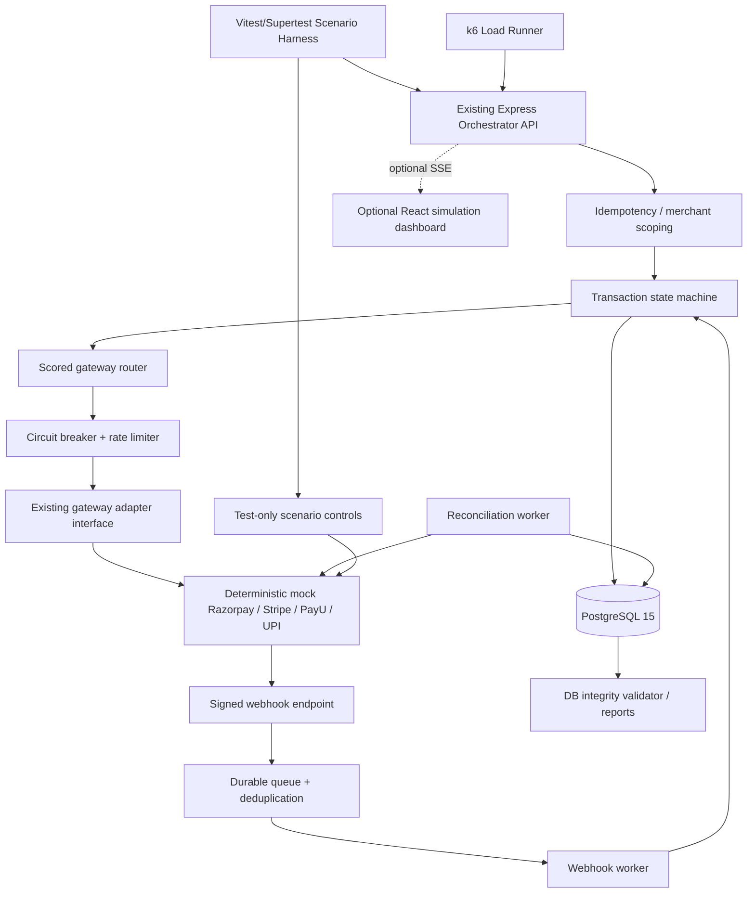
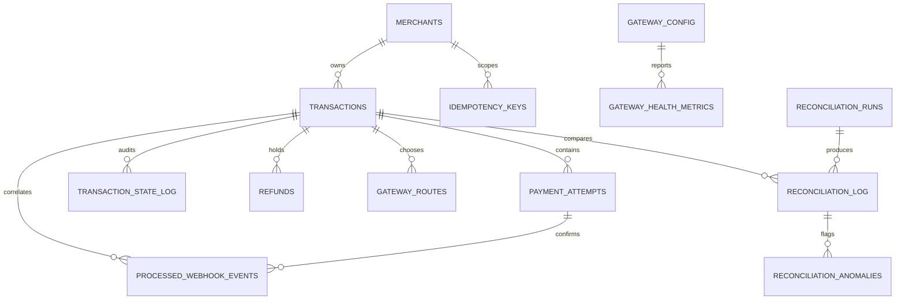

# Zetheta Part B — Codex Master Implementation Prompt

> **Scope:** ONLY **Part B: GAMIFIED SIMULATION BUSINESS CONCEPT**, **printed PDF pages 24–33** (§B1–B5) of `Zetheta_Backend_project.pdf`.
>
> **Purpose:** A self-contained, implementation-level brief for an autonomous coding agent working inside the **existing, already completed Part A payment orchestration repository**. Part B is **primarily a backend simulation, failure-validation, load-testing, and reproducible deployment exercise**. **A React dashboard is OPTIONAL, a presentation layer only, and must never delay or replace mandatory backend correctness.**
>
> **Authority:** `[PDF-B]` indicates an instruction/criterion stated in Part B, with page citations; `[ENGINEERING]` means a recommended implementation design or security improvement, not a direct PDF mandate; `[CONFLICT]` indicates internally inconsistent, incomplete, or potentially unsafe instructions needing a documented approach. Do not silently present recommendations as PDF requirements.
>
> **Companion material:** `Zetheta_Codex_Master_Implementation_Prompt.md` (Part A architecture), `Zetheta_Part_A_Complete_Database_Schema.md` (existing database contracts), and `Zetheta_Backend_project.pdf` (authoritative original). Preserve compatible Part A behaviors and tables. **Do not rebuild Part A from scratch.**
>
> **Important:** This is an execution specification, not a claim of defect-free software. The agent must run real tests, record evidence, identify defects/limitations, and NEVER claim zero errors, guaranteed scoring, live payment certification, or verified external evaluation.

---

## 0. FIRST INSTRUCTION TO THE CODING AGENT — READ AND EXECUTE

You are the lead payment-systems engineer, senior TypeScript developer, performance engineer, and test engineer for the already implemented Part A application. **Implement all mandatory Part B functionality end-to-end, integrated into the existing code.** Do not stop at planning, adding placeholder tests, writing a standalone fake orchestrator, or drawing an architecture diagram.

1. Inspect the repository (`README`, package scripts, `src/`, existing API/adapter/worker code, migrations, schema and tests). **Adapt to real existing names**, not blindly to proposed paths below. Avoid destructive or unnecessary refactors.
2. Read **only pages 24–33 for Part B requirements**, and consult Part A/its companion MD files to understand existing integration contracts. Do not introduce new obligations from Parts C–F. Part B page 24 mentions Part F as evaluation reference; that mention does not authorize using Part F as a new implementation scope.
3. Make a requirements traceability matrix `docs/part-b/requirements-matrix.md` with section, printed page, `[PDF-B]` vs `[ENGINEERING]` vs `[CONFLICT]`, code path, test path, and actual pass/fail evidence. Keep this current.
4. Start with a **gap analysis** of Part A against Part B. If the source tree already implements a requirement correctly, reuse it and add missing automated evidence. If an earlier Part A choice conflicts (e.g. global idempotency keys rather than merchant-scoped keys), write a safe migration with compatible tests. Do not silently change financial data.
5. Prioritize **payment correctness**: no duplicate charges; no incorrect failover after unknown outcomes; no invalid states; no duplicate capture/refund; no lost acknowledged webhooks; no forged webhook acceptance; no financial mismatch concealed by a passing test.
6. All simulations run **without external internet** using deterministic mocks. Do not call live payment providers, generate real charges, require external accounts, or download packages at container runtime. Do not collect/stash PAN, CVV, UPI PIN, or real credentials.
7. Implement integration tests backed by **actual PostgreSQL 15**, not mocked repository objects for DB race-safety evidence. Unit tests may use mocks for isolated pure functions.
8. Build an automated **15-scenario suite**, 6 benchmark checks, full integrity audit and a one-command Docker Compose run. Use fixture isolation/reset that does not destructively reset production data.
9. Make failures visible: explicit scenario pass/fail with reason, test and performance outputs, machine-readable report, and documented deviations. Never fabricate measured benchmark results or output a pass when a test was skipped.
10. Use the optional React dashboard only **after** mandatory Part B checks are complete; keep it behind an optional Compose profile and never make it required for `/api/v1/health` or the automated tests.
11. Run all feasible commands in the working environment and fix errors. If tools/dependencies/VM capacity are unavailable, report precise limitations and the commands to reproduce; do not assert unperformed validation.
12. Finish with a concise report of code changes, all FS-01–FS-15 outcomes, each benchmark outcome, Docker startup time, database audit outcome, remaining deviations and their safety consequences.

**Do not claim completion until all mandatory features have implementation and test evidence.** Do not write `TODO` placeholder handlers or unconditional success branches in the required solution. Keep test-only mock control endpoints authenticated/isolated and disabled for non-simulation environments.

---

## 1. SOURCE SCOPE AND BUSINESS MODEL

### 1.1 [PDF-B] B1, pp. 24–25: fictional PayFlow Commerce context

- Company: PayFlow Commerce Private Limited, fictional Mumbai D2C retailer in lifestyle/electronics/fashion.
- Monthly GMV **₹45 crore**, average order **₹2,800**.
- Transaction volume **105,000/day average**, **180,000/day peak**.
- Providers **Razorpay, Stripe, PayU, UPI (NPCI in the narrative)**; methods credit card, debit card, UPI, net banking, wallet. **A mock UPI adapter is required; do not treat this as permission to integrate directly with NPCI.**
- Baseline payment success **88.2%**, business target **96%+**. Baseline average latency **3.2 s**, target **under 1.5 s**.
- Stated failure-related monthly revenue lost **₹5.3 crore**; it is a fictional business input, not a value to fabricate from test data.
- Six problems to demonstrate improvement: **P1 silent failures** (4,200/day); **P2 double charges** (~180 customers/month); **P3 unreconciled payments** (₹12 lakh/month); **P4 slow checkout** (32% cart abandonment during 6–9 PM); **P5 missing audit history**; **P6 outage detection** (average 45 minutes).

[ENGINEERING] Use these metrics only in mock business fixtures, documentation, optional dashboard labels and scenario narratives. **Do not label seeded historical data as actual measured outcomes.**

### 1.2 Part B = verification of Part A, not a new storefront

The deliverable is a deterministic testing/simulation environment that drives the **real orchestrator** through real REST APIs and real PostgreSQL transactions. Must exercise its adapters, score-based router, circuit breakers, state transitions, idempotency, webhook queue, reconciliation and logs. A customer-facing shopping site and live payment SDK integration are **not needed** for Part B.

### 1.3 Original gamification concept

[PDF-B, p.24] The PayFlow narrative and gamified concept are a **reference framework**, and students may choose a different concept if it meets referenced assessment criteria. For this implementation retain **PayFlow Commerce** and the exact FS/B3/B4 assessment interfaces, because it is simpler and reproducible. [ENGINEERING]

---

## 2. TECH STACK AND MAINTAINABILITY CONTRACT

| Area | Choice | Authority | Why / boundary |
|---|---|---|---|
| Core backend | Existing **Node.js + TypeScript + Express.js** | ENGINEERING / preserve Part A | Reuse all previous domain logic |
| Source of truth | **PostgreSQL 15** | PDF-B p.31 + Part A | Durable transactions, locks, audit, queue |
| DB access/migrations | Existing `pg` / Knex or equivalent | ENGINEERING | Reuse existing migration chain |
| Mock gateways | TypeScript HTTP service (Express/Fastify or existing adapter mocking infrastructure) | PDF-B p.32 requires behavior, implementation ENGINEERING | Deterministic external provider behavior |
| Functional/unit/integration tests | Existing framework or **Vitest + Supertest** | ENGINEERING | API, workers, DB race tests |
| Load tester | **k6 or Artillery** (prefer k6) | PDF-B p.30 | 100 req/s for 5 minutes + metrics |
| Containers | **Docker Engine 24+**, **Compose v2** | PDF-B p.31 | One-command offline boot |
| Queue | Existing durable PostgreSQL queue or Redis Streams if already present | ENGINEERING / preserve Part A | Verified persistence + retries + DLQ |
| Workers | Existing Node webhook/reconciliation workers | ENGINEERING | Separate runnable processes where applicable |
| Logging | Existing JSON structured logger (Pino if available) | ENGINEERING / Part A | Correlation IDs, diagnostics |
| Pooling | Existing bounded PG pool, PgBouncer or equivalent | PDF-B FS-14 p.29 | Backpressure and connection conservation |
| Live dashboard | **React + TypeScript + Vite + Tailwind + Recharts; SSE** | OPTIONAL ENGINEERING | UI only, no business rules |

**Avoid mandatory Kafka/Kubernetes/real merchant accounts/microservice rebuilds.** Reuse one repository and existing interfaces; external mocks may be independent containers while remaining inside same repo.

---

## 3. TARGET ARCHITECTURE AND DATA FLOWS



### Flow A — payment simulation

1. Scenario runner creates a uniquely scoped `merchant_id`, `merchant_order_id`, `Idempotency-Key`, trace ID, and a payment request specifying card/UPI/etc.
2. Simulation-only ingress maps permitted `X-Mock-*` test controls to a request-scoped test context and/or mock provider, **never persisting these as public untrusted production settings**. Do not allow unauthorized arbitrary clients to force payments to succeed.
3. Real Express payment API authenticates/scopes merchant; validates request; atomically reserves idempotency key; commits initial transaction state and audit log; selects an eligible route.
4. Real adapter sends HTTP to mock provider; mock returns deterministic status/latency/failure. Record attempt ID/provider reference/outcome and route details; update circuit breaker and state as allowed.
5. Return accurate API result; receipt/unknown statuses must not be falsely declared as captured. Test harness asserts API, DB, and mock call counts.

### Flow B — webhook simulation

1. Mock provider creates **valid gateway-specific signed webhook bytes** (with event ID/provider reference/amount as applicable) and posts to real webhook endpoint.
2. Verify signature over **raw request bytes**, check replay protection and provider event uniqueness `(gateway,event_id)`, durably queue and acknowledge.
3. Worker atomically processes state/accounting change and audit, while acknowledging duplicate/out-of-order events safely.
4. Test harness checks exactly-once *financial effect* (even when webhook delivered at least once), not an unrealistic exactly-once transport claim.

### Flow C — reconciliation simulation

1. Scenario seeds known gateway status and internal recorded states for a set of transactions, then invokes real reconciliation trigger.
2. Reconciliation queries mock status/settlement endpoint and compares against internal state.
3. Persist anomaly and alert/notification log for mismatches; do not automatically refund disputed settlement discrepancies.
4. Compare results to fixtures and generate accuracy + runtime report.

### Flow D — optional dashboard

React calls existing **read-only metrics/health/status** REST routes and optionally subscribes via SSE to sanitized simulation events; admin scenario triggering uses a protected simulation-only API. **The UI never executes or replaces the router, payments or gateway logic.**

---

## 4. CONCRETE MODULES, INTERFACES AND DIRECTORY PLAN

**First inspect existing paths.** The following names are suggestions, not grounds to duplicate working modules.

```text
src/
  modules/
    payments/                   # Existing Part A, extend only if needed
    idempotency/                # Existing: merchant-scoped key fix
    state-machine/              # Existing: settlement/refund/expiry/rejected transition handling
    gateway-router/             # Existing: method fit, health, load-dependent choice
    circuit-breaker/            # Existing: per provider/payment method
    webhooks/                   # Existing: real verified raw-body processing
    reconciliation/             # Existing: anomalies and status polling
    simulation/                 # NEW: test-mode config, scenario controller, fixtures
      simulation.routes.ts
      scenario-config.service.ts
      scenario-runner.ts
      test-auth.middleware.ts
    gateway-mocks/              # NEW: four deterministic simulated providers
      app.ts
      mock-control.ts
      mock-state.store.ts
      mock-signatures.ts
      razorpay.mock.ts
      stripe.mock.ts
      payu.mock.ts
      upi.mock.ts
  workers/                      # Existing or reused
  database/migrations/          # Add additive migrations only
  database/seeds/              # Deterministic, isolated fixture seed

tests/
  part-b/
    scenarios/FS-01.test.ts ... FS-15.test.ts
    helpers/fixtures.ts
    helpers/mock-gateway-client.ts
    helpers/db-assertions.ts
    helpers/parallel-requests.ts
    integrity.test.ts
    health-startup.test.ts
    benchmark-contracts.test.ts

performance/
  k6/payment-initiation.js
  k6/sustained-load.js
  k6/webhook-latency.js
  k6/failover.js
  k6/idempotency.js
  k6/reconciliation.js
  README.md

scripts/
  part-b-test.sh
  part-b-integrity.sh
  part-b-benchmarks.sh
  part-b-report.ts
  part-b-reset-fixtures.ts

docs/part-b/
  requirements-matrix.md
  architecture.md
  scenario-catalog.md
  benchmark-methodology.md
  known-deviations.md
  results.md
  integrity-queries.sql
  simulation-api.openapi.yaml

# OPTIONAL, after mandatory acceptance is met:
web/dashboard/
  src/{pages,components,api,hooks}/
  package.json

docker-compose.yml
Dockerfile
.env.example
```

### Shared gateway contract (illustrative, adapt to the existing Part A type)

```ts
type MockMode = 'success' | 'timeout' | 'server-error' | 'decline' | 'rate-limit';

type MockControl = {
  mode: MockMode;
  delayMs: number;            // bounded / validated
  gatewayDown: boolean;
};

type AttemptOutcome =
  | { status: 'CONFIRMED_SUCCESS'; providerReference: string; gateway: string }
  | { status: 'CONFIRMED_FAILURE'; reason: string; gateway: string }
  | { status: 'UNKNOWN'; reason: string; gateway: string };

// Test-only controllers set request-scoped behavior, never a shared mutable
// global default that leaks across concurrent merchants/transactions.
```

**Required control attributes:** gateway, payment method, merchant/order scope, attempt ID, operation (authorize/capture/void/refund/status), trace ID, test scenario ID, and optional deterministic logical timestamps. Mock event IDs and provider references must remain stable for the same attempt and distinguish different attempts.

---

## 5. MOCK GATEWAY HTTP CONTRACT — MANDATORY

### 5.1 [PDF-B] B4.3, p.32: exact test control headers

| Incoming test header | Mock behavior |
|---|---|
| `X-Mock-Response: success` | Successful auth/capture operation as appropriate |
| `X-Mock-Response: timeout` | **No response for 30 seconds** as specified; expose test-time control so test suite can use short timeouts without waiting 30 sec in every unit test |
| `X-Mock-Response: server-error` | HTTP **502 Bad Gateway** |
| `X-Mock-Response: decline` | Deterministic declined/insufficient-funds response |
| `X-Mock-Response: rate-limit` | HTTP **429** with valid `Retry-After` |
| `X-Mock-Delay-Ms: 2000` | Delay response **2,000 ms** |
| `X-Mock-Gateway-Down: true` | Simulate completely unreachable service |

**Agent instruction:** support these precise header spellings and values, not only custom JSON controls. Validate case-insensitively (HTTP standard), reject unsupported modes and invalid delay values with a controlled error, and prevent these headers from affecting production endpoints. If externally injected test headers pass through your API, document the exact propagation path to the mock and prove that it is inaccessible in non-test mode.

### 5.2 [ENGINEERING] Mock endpoints and behavior

Provide adapter-compatible routes for each gateway, minimally:

```text
POST /mock/:gateway/authorize
POST /mock/:gateway/capture
POST /mock/:gateway/void
POST /mock/:gateway/refund
GET  /mock/:gateway/payments/:providerReference
GET  /mock/:gateway/settlements/:providerReference
POST /mock/:gateway/admin/events/emit                 # simulation-only, protected
PUT  /mock/:gateway/admin/scenarios/:scenarioId       # simulation-only, protected
POST /mock/admin/reset                                # simulation-only, protected
GET  /mock/health
```

The orchestrator's adapter must map these to its own **existing** interface; do not change the public `/api/v1/payments` contract merely to mimic provider route naming. Keep separate provider response shapes if already implemented in Part A.

For every attempt the mock must record operation count and deterministic provider lifecycle (authorized, captured, partial, voided, refunded, expired, settlement outcome). Include a **status lookup endpoint** that can report a definitive late success after an earlier API timeout, to ensure recovery logic is safe. Provide webhook event creation for capture/refund/expiry and knobs for out-of-order, delayed and duplicate delivery. Return `429` and a test-controlled `Retry-After` in proper units.

### 5.3 Signature verification fixtures

Generate valid HMAC signatures for mock Razorpay/PayU as appropriate to the implementation's documented mock security contract, Stripe-style signature **with timestamp and signed raw bytes**, and a mock UPI callback signature only if consistent with configured mock integration. Do not assert a simulated UPI callback proves real NPCI certification. For FS-10, generate one legitimate signed event, mutate the exact body bytes **after** signing, replay unchanged signature, expect `401`, no state mutation and a redacted security audit log including source IP (respect trusted-proxy settings). Signature comparison must be constant time with matching byte lengths. Avoid replay acceptances outside specified tolerances.

### 5.4 Fixture determinism, isolation and cleanup

- Unique seeded provider reference ID per attempt; unique event ID per event; repeated deliveries reuse the exact event ID and raw bytes.
- Per-test transaction or scenario namespace; reset mocking state and **test-owned** database rows only. Do not `TRUNCATE ... CASCADE` uncontrolled tables.
- Use isolated test DB/schema and test-only keys/secrets; never reset a real merchant environment.
- Avoid time-based flakes: fake clocks for unit tests, controlled logical event times, explicit barriers for concurrency, bounded polling in integration tests.
- If using SQLite/in-memory tests for pure logic, they **cannot** substitute for PG advisory-lock, `SELECT FOR UPDATE`, unique-index or pool-exhaustion integration tests.
- Preserve DB seeded historical gateway statistics / routing weights from Part A where necessary for reproducible gateway ranking; do not inadvertently override the routing formula with fixed `if (scenario === ...)` conditions.

---

## 6. FAILURE SCENARIOS — REQUIRED EXECUTABLE ACCEPTANCE CONTRACTS

Implement one deterministic integration test for each FS number **and** narrow unit tests for key edge cases. The expected behaviors below preserve the PDF wording; if unsafe or ambiguous, note the difference under `[CONFLICT]` and add separate safety assertions. All assertions must inspect at minimum API response, actual PostgreSQL state/audit/event tables, mock gateway call counts, and trace logs when applicable.

### FS-01 — Gateway timeout during authorization (50 points; p.26)

**[PDF-B] Setup:** Razorpay auth no response for 30 s. Expected: timeout counted by circuit breaker, router reselects Stripe (next highest), `AUTH_INITIATED → ROUTE_SELECTED` for new gateway, total failover under 2 s.

**Implement:** short orchestration attempt deadline; persistent attempt trace; record timeout and circuit-breaker failure; select Stripe if method compatible and score/health support it; new attempt references correct payment. Measure from first gateway failure **detection** to alternate response, separately from the full 30 s mock duration.

**[CONFLICT]** A timed-out request may have executed; immediate reroute may double-charge. **Never issue a competing authorization unless the original attempt's outcome is verified non-executed/failed or test mock guarantees non-execution.** Implement distinct test modes: (1) confirmed no-side-effect timeout permitting safe failover, and (2) ambiguous timeout ending as `UNKNOWN`/pending reconciliation with **zero alternate charge**. If the PDF's strict 30 s silence and 2 s total completion are impossible together, document the timing definition and discrepancy; do not fake time.

**Assertions:** breaker failure count increments; route log includes both gateways only when safe; gateway charge count <= 1 for the logical payment; no illegal intermediate transition; safe-failover timing <2 s when feasible; unknown-outcome test blocks alternate charge.

### FS-02 — Duplicate webhook three times (50 points; p.26)

**[PDF-B]** Razorpay sends same `payment.captured` webhook 3 times within 10 s. First updates to `CAPTURED`, next two return HTTP 200, no duplicate state transitions/financial records.

**Assertions:** `processed_webhook_events` unique `(gateway,event_id)` row; exactly one successful capture state transition and one accounting effect; three HTTP 200 responses after safe durable acknowledgement; no duplicate queue financial processing. Include concurrent duplicate webhook deliveries.

### FS-03 — Customer double submit (50 points; p.26)

**[PDF-B]** Two identical quick requests with same idempotency key; one proceeds, other receives **409 Conflict while PROCESSING**; one gateway charge.

**Assertions:** deterministic barrier ensures second request races while first still PROCESSING; exactly 1 gateway call/charge, 1 transaction; after first completes, same key+body returns cached outcome per Part A; same key+different body returns conflict; do not mistake network race nondeterminism for proof.

### FS-04 — HTTP 502 during capture (50 points; p.26)

**[PDF-B]** PayU authorization successful, capture HTTP 502, exponential backoff of **1 s, 2 s, 4 s**, then `CAPTURE_FAILED` after 3 failed retries; query status endpoint for late success.

**Implement:** define and document whether “3 failed retries” means 3 retries **after** initial request or 3 total attempts (source ambiguous). Parameterize capped retries. Use provider-side idempotency and same capture attempt identity; never create multiple captures. For genuine uncertainty, reconcile provider status before permitting a new non-idempotent capture.

**Assertions:** expected delays via fake clock or measured event timestamps; bounded number of retry calls; late-success status becomes `CAPTURED` exactly once; confirmed unsuccessful path reaches `CAPTURE_FAILED` only when provable; no duplicate capture amounts.

### FS-05 — Partial capture ₹800 of ₹1,200 (50 points; p.27)

**[PDF-B]** Authorized 1,200 INR, capture 800, `PARTIALLY_CAPTURED`, remaining 400 held; capture remainder or void remaining; audit tracks amounts.

**Assertions:** use integer minor units `120000`, `80000`, `40000` for INR; `captured + remaining <= authorized`; concurrent capture attempts cannot exceed authorized total; void remainder releases only uncollected hold; use provider capabilities and explicit mock support rather than assuming all providers allow multiple captures; audit immutable and amount-consistent.

### FS-06 — Webhook before API response (50 points; p.27)

**[PDF-B]** Stripe `payment_intent.succeeded` arrives while API response pending at `AUTH_INITIATED`; webhook moves state to `CAPTURED`; later API response must be gracefully ignored as stale/duplicate, without error/double effect.

**Implement:** transaction/attempt mapping persisted before outbound gateway call; event handler validates semantics for Stripe's simulated `payment_intent.succeeded`; lock and state version or monotonic transition rule; stale API response does not regress state. Do not mark a merely authorized-only payment captured based on an unrelated event.

**Assertions:** final `CAPTURED`; one capture financial effect; no stale regression to `AUTHORISED`; no unhandled exception; trace correlation consistent.

### FS-07 — Cascade failure (75 points; p.27)

**[PDF-B]** Razorpay down/open breaker, PayU degraded to 80% success, Stripe rate-limited 429; eligible traffic to UPI; non-UPI queued for Stripe with exponential backoff respecting `Retry-After`; PayU gets reduced allocation and Razorpay gets none.

**[CONFLICT]** Card payments cannot be silently changed to UPI. Enforce payment-method fit: UPI requests may route to eligible UPI provider; card/net-banking requests queue/retry compatible providers or fail explicitly after policy limits. Not all traffic may be redirected to UPI. In a deterministic route/distribution fixture, lower PayU's share using health/scoring, not hard-coded scenario branches.

**Assertions:** zero calls to open-breaker Razorpay, 429 cooldown respected without hot-looping, queue durable, eligible UPI only, non-UPI never silently converted, routing score/health logs reflect changing metrics.

### FS-08 — Refund of already-settled payment (50 points; p.27)

**[PDF-B]** Refund a payment captured 3 days prior and now `SETTLED`; within permitted refund window, `SETTLED → REFUND_INITIATED → REFUNDED`.

**Implement:** add legal settled-refund transition if missing; verify amount and eligibility, prevent repeated refund; gateway adapter uses mock refund API; settlement and refund are separately auditable. Handle `PARTIALLY_REFUNDED` where applicable.

**Assertions:** legal transition and one gateway refund; no refund > captured minus refunds; replay with same idempotency key reuses result; refund original captured amount not overwritten by settlement flag.

### FS-09 — Two-server idempotency race (75 points; pp.27–28)

**[PDF-B]** Two distinct application processes/instances get same merchant+idempotency key simultaneously; one processes, other returns 409; database-level advisory or row locking; never two charges.

**Implement:** launch two **actual API instances with one PostgreSQL** in integration/Compose test, coordinate simultaneous dispatch via barrier; use atomic `INSERT ... ON CONFLICT` + uniqueness/transactional locking, not per-process memory mutex. Record one winner and one conflict, independent of node scheduling.

**Assertions:** 1 transaction, 1 gateway attempt, 1 provider charge, 1 idempotency record, 409 loser, proper response cached afterward. Run repeated races.

### FS-10 — Tampered webhook replay (50 points; p.28)

**[PDF-B]** A legitimate Razorpay webhook is replayed with changed payment amount from ₹100 to ₹10,000 using its old signature. Expect HTTP 401, no payment change, security audit with source IP.

**Assertions:** compute original valid signature over raw bytes; alter amount without recomputing signature; invalid signature rejected before queue/dedupe/state effects; malicious payload not persisted as trusted financial data; log redacted IP and reason; also confirm exact unchanged duplicate legitimately returns 200.

### FS-11 — Five missing/reversed settlements (75 points; p.28)

**[PDF-B]** Five internally `CAPTURED` payments appear failed/reversed on settlement provider report. Create five `ANOMALY` records, flag `RECONCILIATION_MISMATCH`, dispatch alert, **do not automatically refund**.

**[CONFLICT]** `RECONCILIATION_MISMATCH` is not in Part A mandatory transaction states. Prefer an explicit `reconciliation_status` or `review_flag`, anomaly rows and audit events while **retaining underlying financial state `CAPTURED`**. If evaluator requires a literal status field, expose a derived `RECONCILIATION_MISMATCH` review status with source/projection clearly documented; do not rewrite payment state in a way that destroys the financial truth.

**Assertions:** 5 distinct anomalies, flagged five transactions, alerts persisted/emitted once, 0 automatic refunds, idempotent re-runs do not duplicate anomaly side effects.

### FS-12 — UPI collect request expires (50 points; p.28)

**[PDF-B]** Collect request unapproved for **5 minutes**, poll mock UPI, callback reports `EXPIRED`, `AUTH_INITIATED → AUTH_EXPIRED`, notify customer, **no forced retry**.

**Implement:** logical/mock clock for fast deterministic test plus real-time integration smoke; model `AUTH_EXPIRED` in FSM with legal transition; callback must be verified under mock contract; notification can be durable outbox/logged test adapter.

**Assertions:** final expired state, 0 captures, 0 retry attempts, one notification event, audit with expiry reason, duplicate expiry callback harmless.

### FS-13 — Same UUID from different merchants (50 points; p.28)

**[PDF-B]** Two distinct merchants reuse same UUID. Idempotency isolation by `(merchant_id, idempotency_key)` composite key; both requests independently proceed.

**Implement:** inspect Part A migration which may currently have global key PK. Add **safe, incremental migration** using merchant identity. Preserve existing key data and do not assume a merchant for historical records without a documented backfill strategy. Scope by merchant **and operation/endpoint where necessary** without breaking the source's composite identity contract. Merchant identity must derive from authenticated server-side context, not blindly from a spoofable client header.

**Assertions:** two different merchants each one charge; same merchant same key dedupes; cross-merchant request hashes and responses cannot leak.

### FS-14 — Flash-sale DB pool exhaustion (75 points; p.29)

**[PDF-B]** 5x load, PG pool max 20 exhausted. Pooling via PgBouncer/equivalent; long reconciliation queries to read replica; queued webhook ingestion; internal circuit breaker for DB/cache cascade protection.

**[ENGINEERING]** Configure bounded `pg` pools/process-level limits, bounded queue depth, timeouts and metrics. Use PgBouncer if available, and a **true local PostgreSQL streaming read replica for reconciliation read queries** if implementing the literal read-replica behavior; document replication lag and do not read stale values as payment truth. If environment cannot support one, do **not** claim a replica exists: mark criterion not fully met, provide tested equivalent isolation + evidence and a deployment-ready replica profile.

**Assertions:** controlled pool saturation causes bounded backpressure/503 or queued 202 (never silent success), no unbounded connection growth, no duplicate charges, webhook events durably buffered and drained, reconciliation reads targeted to replica when configured and reconciles authoritative primary before financial writes.

### FS-15 — Forbidden state transition (50 points; p.29)

**[PDF-B]** An attempted `CREATED → REFUNDED` jump must throw `InvalidStateTransitionException`, log `REJECTED_TRANSITION`, and report allowed transitions from `CREATED`.

**Implement:** invalid attempts must **not change current financial state**; append redacted security/audit rejection in a separate committed transaction if the transition transaction rolls back. Decide whether rejected event is stored in `transaction_state_log` as a non-transition event (requires compatible schema) or dedicated rejection audit table/view, and expose in timeline without fabricating an actual state transition.

**Assertions:** state remains `CREATED`; rejected event persists; error type/message conveys valid transitions; no refund/charge side effects.

### Failure-suite pass criteria

- All 15 scenario test files exist; tests are executed in CI and local Compose; no skipped tests counted as passed.
- Document **test fixture**, request headers, expected mock response, source page, expected API results, exact state/audit assertions, gateway provider call counts, and verification output for each.
- Report **numeric scores only if computed from actual executed tests**. Never invent a leaderboard score or imply official grading.
- Detect and report semantic disagreements between the PDF's expected assertion and payment safety. Prefer honest safety-compliant deviations over forced financial corruption; clearly identify where official evaluator behavior might differ.

---

## 7. DATABASE AND MIGRATION REQUIREMENTS

Start from the Part A schema document and actual migrations; do not recreate the existing 10+ tables unconditionally. The authoritative table/column names are those in the running repository.

### 7.1 Cross-entity relationships to preserve



This is a *conceptual extension*: `merchants`, `reconciliation_runs`, `reconciliation_anomalies` may already exist or may need compatible mapping. Only create a table when necessary. Existing Part A support tables take precedence.

### 7.2 Mandatory integrity rules

- Financial amounts in **integer minor units** (`BIGINT`) and currency recorded; no floating-point financial arithmetic.
- Unique `(merchant_id, idempotency_key)` (or composite PK plus appropriately scoped operation) to meet FS-13. Unique provider attempt reference scoped by gateway, immutable attempt ID; unique `(gateway,event_id)` for webhook dedupe.
- Parent FK for every attempt/refund/route/state audit/reconciliation outcome. No orphaned records.
- `captured_total <= authorized_total`; `refunded_total + pending_refunds <= captured_total`; no capture/refund negative or overflow. Preserve separate remaining authorization hold.
- `SETTLED` remains refundable when eligibility allows; reconcile anomalies separately from actual state.
- No external HTTP calls inside SQL transaction/row lock; transaction state and audit written together using short lock/commit operations.
- Append-only financial audit, including rejected transition (in a separate committed log if required), reconciliation overrides, and consistent trace IDs.
- Provider timeout/outage marks attempt **UNKNOWN** until proven otherwise; do not overwrite references on reroute.
- Webhook dedupe claim + durable enqueue is atomic; processing financial effect + event completion is atomic; worker crash/retry safe.

### 7.3 Migration/backfill guidance

1. Inspect existing schema and migration chain, snapshot the test DB, and run a forward-only upgrade in an isolated PG15 container.
2. For merchant scope, add merchant FK/nullable columns first, backfill from known transaction merchant associations only, validate consistency and enforce constraints after verification; do not invent unknown merchant ownership. If legacy data cannot be backfilled safely, state the migration blocker and preserve it rather than drop it.
3. Make new indexes concurrently only where migration framework supports non-transactional DDL and DB is large. Test on clean DB and upgraded Part A DB.
4. Migrations are idempotent with migration ledger; rollback behavior documented; no production destructive reset.
5. Seed mock gateway settings, fixed routing matrix and scenario-specific fixture data in test database only.

### 7.4 Integrity audit queries and machine-readable results

Create `docs/part-b/integrity-queries.sql`, and a runner that returns nonzero exit status if **any invariant violation** occurs. Include checks for:

1. Orphan transactions, attempts, routes, refunds, webhook links, state logs.
2. Duplicate `(merchant_id,idempotency_key)` or `(gateway,event_id)`.
3. More than one provider charge for one logical payment without a proven safe separate attempt.
4. Captures over authorization; refunds over captured; remaining hold mismatch; negative balances.
5. Illegal committed state transitions, missing audit logs, invalid terminal state reactivation.
6. Settled/refund accounting consistency, and zero auto refunds during FS-11 mismatch.
7. In-flight unknown attempts with incorrectly dispatched competing gateway charges.
8. Queue events acknowledged without durable storage or completed processing.
9. Unresolved reconciliation anomalies that are unflagged or lost.
10. Trace ID presence for all significant state/route/refund events.

Document each query's interpretation; never call an ambiguous count “duplicate charge” merely because multiple *failed* gateway attempts exist.

---

## 8. PERFORMANCE BENCHMARKS — EXACT B3 CONTRACT

[PDF-B p.30] All six targets below **must be instrumented and actually measured**. Use k6/Artillery for load and internal traces/timestamps for boundaries not observable from HTTP alone.

| Metric | Official target | PDF weight | Start / stop definition |
|---|---|---|---|
| Payment initiation P95 | **< 500 ms** | **20%** | API request received → gateway call **initiated** (not full provider response) |
| Gateway failover latency | **< 2 seconds** | **25%** | Primary failure **detected** → alternate gateway response |
| Webhook processing P95 | **< 200 ms** | **15%** | Webhook HTTP receipt → corresponding state transition **committed** |
| Concurrent payment handling | **100 requests/sec sustained for 5 minutes** | **20%** | k6 **constant-arrival-rate**, not merely 100 virtual users |
| Idempotency duplicate check | **< 10 ms** | **10%** | Duplicate key lookup → cached response returned |
| Reconciliation batch | **10,000 transactions in < 30 seconds** | **10%** | Trigger/start → durable reconciliation end and complete results |

**Performance instrumentation:**

- Use monotonic durations within a process, and distributed tracing with correlation/trace IDs across workers; do not compute single-process nanosecond differences across hosts.
- Export timing histograms/structured event traces and generate per-scenario results. Use `p95` rather than mean/median for the relevant targets.
- Distinguish webhook HTTP ACK latency from **commit latency**; measure both, grade against commit latency.
- Verify actual achieved **arrival rate** and successful+failed response breakdown; report dropped iterations, thresholds, error rate and saturation.
- Use varied unique merchant orders for throughput, and separate repeated-key fixtures for idempotency measurements; otherwise load testing just measures cache hits.
- Control mock gateway latency; report benchmark results under both nominal and failure modes.
- Supply sample commands to launch k6 against Compose network, e.g. `k6 run performance/k6/sustained-load.js` in an environment with k6 available. Do not make k6 download at runtime when network is unavailable; use prebuilt/cached image or preinstalled binary.
- Reconciliation must produce correct counts/outputs, not just finish within target. Check all 10,000 fixture transactions and anomalies.
- Use reasonably bounded RAM/CPU DB settings on the stated VM; no inflated throughput claims from unrealistic skipped DB operations.

### Acceptance gates for benchmarking

For each metric, produce actual value, target, unit, method, measured environment, timestamp, test command, fixture configuration, and pass/fail; include raw k6 JSON or equivalent result, plus a human-readable report. A metric is **unverified**, not `PASS`, if the environment cannot execute its measurement.

---

## 9. DOCKER / OFFLINE EVALUATION PROTOCOL

### 9.1 [PDF-B] B4.1 pp.31–32: evaluator environment

- Ubuntu **22.04 LTS**, Docker Engine **24.0+**, Compose **v2**.
- VM **4 vCPU**, **8 GB RAM**, **50 GB SSD**, internal network **1 Gbps**, **no external internet**.
- **PostgreSQL 15** launched via Compose.
- `docker compose up` must start the application and make its **health endpoint return healthy within 60 seconds**; otherwise evaluation aborts.

### 9.2 Recommended Compose services

```yaml
# Illustrative only: adapt real repo build paths, commands, probes and secrets.
services:
  postgres:
    image: postgres:15
    environment:
      POSTGRES_DB: payment_orchestrator
      POSTGRES_USER: payment_app
      POSTGRES_PASSWORD: ${POSTGRES_PASSWORD:?Set a local test password}
    healthcheck:
      test: ["CMD-SHELL", "pg_isready -U payment_app -d payment_orchestrator"]
      interval: 2s
      timeout: 2s
      retries: 20
    volumes: ["pgdata:/var/lib/postgresql/data"]

  mock-gateways:
    build:
      context: .
      dockerfile: Dockerfile
    command: ["node", "dist/modules/gateway-mocks/app.js"]
    environment: { NODE_ENV: simulation }
    healthcheck:
      test: ["CMD", "node", "dist/healthcheck.js", "http://127.0.0.1:4100/mock/health"]
      interval: 2s
      retries: 20

  api:
    build: .
    command: ["node", "dist/server.js"]
    depends_on:
      postgres: { condition: service_healthy }
      mock-gateways: { condition: service_healthy }
    environment:
      NODE_ENV: simulation
      DATABASE_URL: ${DATABASE_URL:?Set DATABASE_URL}
      MOCK_GATEWAY_BASE_URL: http://mock-gateways:4100
    ports: ["3000:3000"]
    healthcheck:
      test: ["CMD", "node", "dist/healthcheck.js", "http://127.0.0.1:3000/api/v1/health"]
      interval: 2s
      timeout: 2s
      retries: 20

  webhook-worker:
    build: .
    command: ["node", "dist/workers/webhook.worker.js"]
    depends_on:
      postgres: { condition: service_healthy }

  reconciliation-worker:
    build: .
    command: ["node", "dist/workers/reconciliation.worker.js"]
    depends_on:
      postgres: { condition: service_healthy }

  # OPTIONAL UI and/or true replica can be specified under separate profiles.
volumes:
  pgdata: {}
```

**Do not copy this sample verbatim without checking actual compiled paths, env variables, migrations, healthchecks and service startup.** The agent must deliver a **working, verified** Compose configuration, including migration execution ordering without race conditions, correct networking and functional mock signature secrets. Avoid `depends_on` alone as a substitute for readiness.

### 9.3 Offline image/dependency strategy

Build and cache all application and k6 images/dependencies **before entering a no-network evaluator**. Supply `docker save` / `docker load` instructions if image preload is required. Avoid installing packages or fetching CDN URLs during container startup. Distinguish a no-internet **runtime** from a build environment that may have network. Document exactly which OCI images must be preloaded and ensure `docker compose up` uses only locally available images or built artifacts within the evaluator's expected procedure. Never claim offline boot tested unless the test was actually performed with network disabled.

### 9.4 Startup and health contracts

- `/api/v1/health` must return healthy only after DB connectivity/migrations and essential dependencies are ready. Expose liveness/readiness separately if available.
- Start a stopwatch at `docker compose up` and poll health; record observed time; enforce **<=60 s** in a startup integration test.
- Worker readiness/queue consumer status must be visible; API healthy alone should not falsely imply full pipeline healthy.
- Use test secrets via `.env.example` placeholders, never commit real secrets.
- Define sensible CPU/memory resource limits compatible with 4 CPU/8GB, consistent logs, restart policy, bounded PG pool connections and worker concurrency.

---

## 10. EXACT EVALUATION EXECUTION ORDER (B4.2)

Run all phases in order and archive artifacts. Reset *test-owned* scenario data between individual FS tests, not the production database.

| Phase | PDF duration | Required work |
|---|---|---|
| **1 — Warm-up** | **30 s** | Send 10 standard successful payments; all succeed |
| **2 — Scenarios** | **~20 min** | FS-01 through FS-15 sequentially, reset scenario state between runs |
| **3 — Load** | **5 min** | 100 payment requests/second using k6 |
| **4 — Reconciliation** | **2 min** | Trigger and verify outcomes against known-good fixtures |
| **5 — Integrity audit** | **5 min** | SQL checks: no orphans, no duplicate charges, amounts reconcile, transitions valid |

Use `scripts/part-b-test.sh` or an equivalent command that orchestrates these stages and exits nonzero on mandatory violations. Provide `--smoke`, `--scenario FS-XX`, `--all`, and `--benchmarks` options or equivalent package scripts. **Do not falsely enforce exactly 20 minutes** if tests finish sooner; the published durations describe evaluator phases, not mandatory artificial sleeps. Note that FS-12's five-minute logical expiration can be simulated using a controlled clock in tests, not by delaying every local test run.

Suggested `package.json` scripts (adapt to actual test runner):

```json
{
  "scripts": {
    "partb:test": "vitest run tests/part-b/scenarios",
    "partb:integrity": "node dist/scripts/part-b-integrity.js",
    "partb:bench": "bash scripts/part-b-benchmarks.sh",
    "partb:report": "node dist/scripts/part-b-report.js"
  }
}
```

Build scripts are **not complete** until their referenced files genuinely exist and have been executed.

---

## 11. SCORING AND REPORTING (B5, p.33)

### [PDF-B] leaderboard weights

| Evaluation category | Weight |
|---|---:|
| Failure scenario pass rate (out of 15) | **40%** |
| Code quality (linting, coverage and review) | **25%** |
| Performance B3 benchmarks | **20%** |
| Architecture documentation / design patterns | **15%** |

PDF also describes top-three recognition and says **under 500/1000 total or fewer than 8 of 15 scenario passes** requires resubmission within 7 days, with further consequences stated in the narrative. **Do not claim the unofficial local test harness assigns Zetheta's actual leaderboard score.** Emit a transparent *local* readiness report only. Official grading is external.

**Quality gate:** TypeScript typecheck pass, lint pass, unit/integration tests pass, measured coverage included, no skipped mandatory tests, formatted code, error handling, signature validation, performance results, migration upgrade tests and architecture traceability. Set coverage threshold appropriate to the existing codebase rather than invent an externally mandated number; report uncovered critical paths.

**Output artifacts:**

```text
artifacts/part-b/
  scenario-results.json
  scenario-results.md
  benchmark-results.json
  benchmark-results.md
  integrity-audit.json
  integrity-audit.md
  docker-startup.json
  test-logs/
  traces/
```

Include timestamps, `git` commit hash, branch, OS/container versions, seeded test fixture IDs (redacted where needed), exact commands, pass/fail/unverified and explanations. Make reports reproducible and reproducibly generated, not hand-edited to imply false outcomes.

---

## 12. OPTIONAL REACT SIMULATION DASHBOARD (IMPORTANT USER REQUIREMENT)

**[OPTIONAL ENGINEERING; NOT REQUIRED BY PART B]** Add a React dashboard **only as an optional presentation layer**. It must be gated by time and completion of mandatory backend tests. It must not be a dependency for API, queue, mock gateways, reconciliation, k6, official grading or Docker health. Add to separate Compose profile such as `--profile dashboard` or run separately using `npm run dev:dashboard`.

### Proposed dashboard stack

- React + TypeScript + Vite, Tailwind CSS, Recharts.
- REST APIs for configuration/read models and protected scenario triggering; Server-Sent Events for read-only updates (WebSockets not necessary unless existing architecture already uses them).
- Consume existing backend endpoints, e.g. `/api/v1/gateways`, `/api/v1/gateways/:name/health`, `/api/v1/gateways/:name/metrics`, `/api/v1/analytics/success-rate`, `/api/v1/analytics/volume`, `/api/v1/payments/:id/timeline`, `/api/v1/reconciliation/reports/:id`; add simulation-only metrics/event routes **only if needed** and documented.

### Optional dashboard screens

1. **Live Overview:** success rate (clearly labelled observed vs seeded), payment volume, p95 initiation latency, failover count, active/unknown attempts, reconciliation mismatches.
2. **Gateway Health:** per-provider/method circuit-breaker states CLOSED/OPEN/HALF_OPEN, 429, response latency and routing score composition.
3. **Payment Timeline:** logical transaction, attempts per gateway, auth/capture/refund/settle audit trail, webhook events, reconciliation flags, trace ID.
4. **Simulation Lab:** select FS-01–FS-15; set permitted mock responses/latencies; start/stop *authorized test-only* scenarios; show per-scenario result, not prewritten green checks.
5. **Performance:** k6 imported results or backend metrics (throughput, p95, latency histograms, pass/fail vs targets), with run IDs and dates.
6. **Reliability:** queued webhooks, DLQ, reconciliation jobs, anomaly details; no raw credentials/payload secrets.

### Optional UI data flow

```text
React Dashboard --GET/status--> Express API --read--> PostgreSQL / metrics
React Dashboard --SSE--------> Express event stream --> sanitized live updates
React Dashboard --POST/test---> test-only scenario controller --> mock gateways
                                     |
                                  Part A engine
```

**Rules:** No business logic duplicated in browser; mock control endpoints disabled in production; authentication for all write controls; CSRF/rate limits/CORS appropriate; responsive accessible UI; do not invent live data; label synthetic values as simulation; UI errors and SSE reconnect are visible; no dashboard work until mandatory code is verified. Optional UI must be documented as **not mandated by Part B**.

---

## 13. DETAILED TEST AND VERIFICATION PLAN

### 13.1 Test layers

1. **Unit**: score normalization, method-fit eligibility, breaker transitions, FSM legal transition table, money arithmetic, retry schedule, mock header parsing, webhook signature functions.
2. **PG integration**: migrations, transaction/attempt persistence, row locks, merchant-scoped unique constraints, webhook enqueue/deduplication, refunds and caps, reconciliation anomalies, audit records.
3. **HTTP integration**: 15 FS scenarios against Express + real PG15 + mock gateway HTTP service; no fake in-memory DB in critical tests.
4. **Multi-instance**: run two API processes for FS-09; prove DB-level dedupe under synchronized race conditions.
5. **Workers**: crash/restart during webhook processing, repeated events, failed attempts, DLQ and replay, out-of-order events.
6. **Load**: steady 100 requests/sec for 5 min, p95 thresholds, resource metrics, recon 10K, pool saturation with concurrent processing.
7. **Security**: invalid/tampered signatures, duplicate valid webhook, unauthorized simulation controls, secret redaction, merchant isolation, amount forgery, replay timestamp.
8. **Packaging**: clean DB bring-up, repeat `docker compose up`, migrations, health in 60s, no external dependencies, optional dashboard profile disabled by default.

### 13.2 Edge cases beyond explicit fifteen (ENGINEERING)

- Repeated `Idempotency-Key` with changed body must be rejected; same body after complete returns same cached result.
- Webhook replay same event ID with a **different** body/signature must not silently overwrite trusted event; invalid signature checked first.
- Missing provider reference, malformed signature, duplicate callback with later status, conflicting gateway responses and out-of-order events.
- PG transaction rollback between queue claim and state mutation; recovery reprocesses safely.
- Rate-limit response `Retry-After` as delta seconds or HTTP date; bounded backoff and jitter; no retry storm.
- Two simultaneous partial captures, two refunds racing, settled refund boundary, currency mismatch, zero/negative amount, integer limits.
- Lost HTTP response after provider processed original charge; status poll resolves, alternative route blocked while unknown.
- Two merchants sharing event UUIDs/idempotency UUIDs; no cross-tenant leakage.
- Database restart midway through load, worker restart, poisoned queue message, health restoration.
- Partial/lagged read replica must never override authoritative payment records.

### 13.3 Test naming and assertion contract

Every test should clearly name scenario ID and expected behavior (for example `FS-02 returns 200 for three duplicate deliveries and creates one capture`). Use `beforeEach` to reset only scenario-specific test data, prepare explicit seeded gateway state, and assert public API behavior **plus** DB state **plus** mock operation count. Use explicit max test duration for intentionally delayed mocks. Store failing logs and deterministic seeds.

### 13.4 Required commands to execute (adapt paths)

```bash
npm ci
npm run typecheck
npm run lint
npm test -- --run
# Start a CLEAN database and services
# Ensure env file uses TEST credentials only
docker compose up --build -d
# Verify health endpoint within 60 seconds
curl --fail http://localhost:3000/api/v1/health
# Run all Part B scenarios against live PostgreSQL and mocks
npm run partb:test
# Run integrity audit against same fixture environment
npm run partb:integrity
# Run performance suite (requires actual k6 installation/image)
npm run partb:bench
# Generate reports from actual outputs
npm run partb:report
```

Do not pretend these exact commands already exist; **create or correctly adapt the package scripts**, then run the final versions.

---

## 14. IMPLEMENTATION PHASES / WORK ORDER

**Phase 0 — Inventory / gap analysis:** map Part A endpoint/gateway contracts, schema, worker implementation and tests against B1–B5. Write feature gap list and protected migrations. No frontend.

**Phase 1 — Deterministic simulation layer:** mock service with **exact `X-Mock-*` headers**, all provider operations, signed callbacks, status polling, scenario isolation, and optional fixture clock. Write mock unit/API tests.

**Phase 2 — Financial correctness fixes:** merchant idempotency, payment attempt tracking, state machine legal settlement refund/expiry/rejection, partial capture/void accounting, no unsafe failover, unknown-outcome reconciliation, signed webhook handling. Migrate/test real PG.

**Phase 3 — Fifteen failure scenarios:** implement FS-01 through FS-15 as executable tests. Add required engine fixes. Store actual scenario report with failures, not generic assertions.

**Phase 4 — Reliability and pressure:** webhook queue/DLQ, per-gateway rate limits, backpressure, cross-instance racing, DB pool limits/read replica as indicated, reconciliation anomaly durability. Verify under faults.

**Phase 5 — Benchmarking:** k6 constant-arrival-rate, instrumentation, all B3 boundaries, 10K reconciliation, correctness after load, raw reports. Tune safe hotspots without bypassing DB/auditing.

**Phase 6 — Offline packaging:** Compose PG15 + API + mock + worker processes, migrations/seeds, health <=60 s, preloaded deps, smoke suite; generate docs and integrity audit.

**Phase 7 — OPTIONAL:** React/Vite simulation dashboard if and only if mandatory acceptance passes. Read-only real observability and protected simulation controls; Compose profile disabled by default.

---

## 15. FINAL DEFINITION OF DONE / ACCEPTANCE CHECKLIST

Required before claiming Part B complete:

- [ ] Existing Part A repository retained; no independent fake orchestrator or destructive rebuild.
- [ ] Part B requirements traced to actual source lines, PDF pages 24–33 and real tests.
- [ ] All **four** gateway mocks function offline with the exact five `X-Mock-Response` modes plus the delay and gateway-down controls on p.32.
- [ ] Scenario runner invokes **real** backend logic and real PostgreSQL transactions.
- [ ] FS-01 through FS-15 each have deterministic integration test, observable assertions and honest result.
- [ ] Concurrency/idempotency tested across two app instances and merchant scopes.
- [ ] Signed/tampered/replayed webhooks tested on raw bytes with durable queue and audit.
- [ ] Attempt-specific provider references, unknown timeouts, captures, settlements, refunds and reconciliation anomalies remain financially correct.
- [ ] All **six B3 benchmarks** measured or explicitly marked unverified with reason; no made-up pass.
- [ ] 100 req/sec for five minutes tested using constant arrival rate with actual processed count and failures reported.
- [ ] Reconciliation of 10,000 records checked for **accuracy and runtime**, not just a timer.
- [ ] PG integrity queries pass with no orphans, double charge, overcapture, overrefund or silent invalid transitions.
- [ ] Real Compose environment on PostgreSQL 15 starts and `/api/v1/health` is healthy in <= 60 seconds, or actual deviation reported.
- [ ] Works without live gateway providers or external internet at runtime; image preloading requirements documented.
- [ ] Code passes actual typecheck, lint, and test suite; coverage and code-quality evidence reported.
- [ ] Security: mock controls test-only; no secrets/PII in reports; merchant isolation verified.
- [ ] `docs/part-b/known-deviations.md` records FS-01 timing/safety, FS-07 method-fit, FS-11 anomaly flag, FS-14 true replica availability and any other evaluation mismatch.
- [ ] PDF Part B is the only **new** feature scope; Parts C–F have not been silently implemented as mandatory.
- [ ] **Optional dashboard** remains optional and, if developed, only displays real simulated backend state.
- [ ] Final report lists complete/partial/unverified requirement counts and the exact reproduction commands.

---

## 16. REFERENCE MAP: PDF PART B ONLY

| Document reference | Printed pages | Requirements |
|---|---|---|
| Note on simulation concept, B1 | 24–25 | Fictional business profile, baselines, P1–P6 |
| B2, FS-01–FS-04 | 26 | Gateway timeout, duplicate webhook, double submit, 502 capture |
| B2, FS-05–FS-08 | 27 | Partial capture, early webhook, cascade failure, settled refund |
| B2, FS-09–FS-13 | 27–28 | Multi-node idempotency, signature replay, settlement anomaly, UPI expiry, merchant-scoped key |
| B2, FS-14–FS-15 | 29 | DB pool exhaustion, rejected state transitions |
| B3 | 30 | Six benchmarks with exact targets, start/stop criteria and weightings |
| B4.1–B4.2 | 31–32 | Offline Ubuntu/Docker/PG VM, 60s boot, five-phase sequence |
| B4.3 | 32 | Mock gateway headers and deterministic response controls |
| B5 | 33 | Leaderboard weighting and stated minimum thresholds |

**Part A** is prerequisite code/context; **Parts C, D, E, F are outside the scope of this prompt**. When the PDF's phrasing creates an impossible/unsafe requirement, preserve the stated objective, document the contradiction, and supply safe measurable alternative plus explicit test evidence.

---

## 17. COPY-PASTE AGENT LAUNCH MESSAGE

> First inspect this entire repository and read `Zetheta_Part_B_Codex_Master_Implementation_Prompt.md`, `Zetheta_Codex_Master_Implementation_Prompt.md`, `Zetheta_Part_A_Complete_Database_Schema.md`, and **only pages 24–33** of `Zetheta_Backend_project.pdf` for Part B requirements. Preserve working Part A functionality and its schema; implement missing Part B mocks, all 15 deterministic failure scenarios, all six measured benchmarks, offline Docker/PG15 execution, reconciliation/integrity audits, and machine-readable reports. Follow the source-vs-engineering labels and flag the FS-01/FS-07/FS-11/FS-14 safety/feasibility issues instead of hiding them. Execute typecheck, lint, tests, migrations, Docker startup checks and available load tests, and report actual outcomes. **Only if mandatory Part B is proven complete, optionally add the React simulation dashboard as a separate presentation layer**, disabled by default. Do not stop after planning; implement and validate end-to-end. Never assert tests you have not run or promise zero defects.
