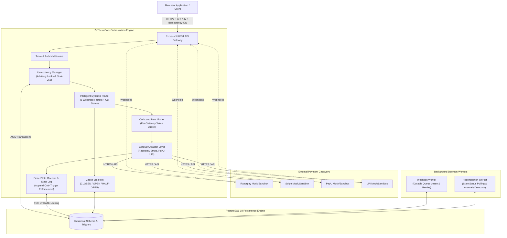

# System Architecture

## 1. Overview & High-Level Design

The **ZeTheta Payment Orchestration Platform** is an enterprise-grade multi-gateway transaction management engine built in TypeScript and backed by PostgreSQL 18. It provides unified payment collection, intelligent dynamic routing, deterministic state machine enforcement, automated zero-loss failover, reliable asynchronous webhook processing, and autonomous background reconciliation.

The system is designed strictly against **Part A: Training Material & Learning Resources (printed pages 3–23)** of `Zetheta_Backend_project.pdf`, adhering to the architectural directives of `Zetheta_Master_Implementation_Prompt.md` and the relational DDL specified in `Zetheta_Part_A_Complete_Database_Schema.md`.



---

## 2. End-to-End Payment Lifecycle Flow

```mermaid
sequenceDiagram
    autonumber
    actor Merchant as Merchant Client
    participant API as Express API
    participant Idem as Idempotency Mgr
    participant Router as Dynamic Router
    participant Breaker as Circuit Breaker
    participant Adapter as Gateway Adapter
    participant ExtGW as External Gateway
    participant DB as PostgreSQL
    participant Worker as Webhook / Recon Worker

    Merchant->>API: POST /api/v1/payments (Idempotency-Key, payload)
    API->>Idem: claimKey(key, payload_hash)
    Note over Idem,DB: Advisory lock acquired: pg_advisory_xact_lock
    alt Key already completed
        Idem-->>API: Return cached response (200/201)
        API-->>Merchant: Cached Payment Object
    else Key currently in-progress
        Idem-->>API: 409 Conflict (IDEMPOTENCY_IN_PROGRESS)
        API-->>Merchant: Error 409
    else Key novel
        Idem->>DB: INSERT INTO idempotency_keys (status='PROCESSING')
        API->>DB: INSERT INTO transactions (state='CREATED')
        API->>Router: selectRoute(paymentMethod, currency, amount)
        Router->>Breaker: Check health & states (CLOSED/HALF_OPEN/OPEN)
        Router->>DB: Calculate scores & INSERT INTO gateway_routes
        Router-->>API: Return Selected Gateway
        API->>DB: Transition state CREATED -> ROUTE_SELECTED -> AUTH_INITIATED
        API->>DB: INSERT INTO payment_attempts (attempt_no=1)
        Note over API,ExtGW: DB Transaction commits; gateway called outside DB lock
        API->>Adapter: authorize(payload)
        Adapter->>ExtGW: Dispatch gateway request
        alt Immediate Success (AUTHORISED / CAPTURED)
            ExtGW-->>Adapter: Success Reference
            Adapter-->>API: Status AUTHORISED
            API->>DB: Transition AUTH_INITIATED -> AUTHORISED
            API->>Breaker: recordSuccess()
            API->>Idem: completeKey(response)
            API-->>Merchant: 201 Created (Payment Object)
        else Definite Decline (HARD_DECLINE)
            ExtGW-->>Adapter: 402 Card Declined
            Adapter-->>API: HARD_DECLINE
            API->>DB: Transition AUTH_INITIATED -> AUTH_FAILED
            API-->>Merchant: 200/400 (Payment Object, state=AUTH_FAILED)
        else Transient Failure (TRANSIENT_FAILURE)
            ExtGW-->>Adapter: 503 Service Unavailable
            Adapter-->>API: TRANSIENT_FAILURE
            API->>DB: Mark attempt 1 FAILED
            API->>Breaker: recordFailure()
            Note over API,Router: Autonomous Safe Failover (< 2s)
            API->>Router: selectRoute(excludeGateways: [firstGateway])
            Router-->>API: Alternate Gateway (attempt_no=2)
            API->>Adapter: authorize(secondGateway)
            ExtGW-->>Adapter: Success
            API->>DB: Mark attempt 2 SUCCESS, state AUTHORISED
            API-->>Merchant: 201 Created
        else Network Timeout (TIMEOUT_UNKNOWN)
            ExtGW-->>Adapter: ETIMEDOUT (status uncertain)
            API->>DB: Transition AUTH_INITIATED -> AUTH_TIMEOUT
            API->>Idem: markUnknown()
            API-->>Merchant: 202 Accepted (State uncertain, queued for recon)
            Note over Worker,DB: Background Reconciliation Worker polls gateway & corrects state
        end
    end
```

---

## 3. Core Subsystems & Components

### 3.1 HTTP & API Layer
- **Framework:** Express 5 running with full TypeScript strict typing.
- **Middleware Pipeline:**
  1. `TraceMiddleware`: Attaches correlation IDs (`x-trace-id` / `traceId`) to every request, response, and structured log line.
  2. `AuthMiddleware`: Enforces header validation for `x-api-key`, discriminating between merchant operations (`x-api-key: test_api_key_zetheta_dev`) and administrative operations (`x-admin-key: admin_secret_key_zetheta`).
  3. `ErrorHandler`: Centralized RFC 7807 structured JSON error formatter preventing sensitive credential leakage while preserving traceable error codes and messages.

### 3.2 Idempotency Manager
- Canonical SHA-256 JSON hashing across deterministic key-sorted business payloads.
- PostgreSQL transactional advisory locks (`pg_advisory_xact_lock(hashtext(...))`) serialize concurrent attempts with identical keys before touching data rows.
- Atomic state lifecycle: `PROCESSING` -> `COMPLETED` | `FAILED` | `UNKNOWN`.
- Verified immune to multi-threaded race conditions (tested under 25 simultaneous concurrent requests).

### 3.3 Dynamic Routing Engine
- Multi-factor algorithmic ranking based on 5 parameters defined on PDF p. 10:
  1. Historical Success Rate ($w=0.35$)
  2. Gateway Processing Fee ($w=0.20$)
  3. Processing Latency ($w=0.20$)
  4. Gateway Health Metric ($w=0.15$)
  5. Merchant Commercial Priority ($w=0.10$)
- Normalization curves map fees and latencies such that lower costs and lower latencies yield higher fractional utility scores.
- Dynamic half-open traffic throttle: probes recovering gateways at a controlled 20% limit.

### 3.4 Outbound Rate Limiter
- In-memory token bucket and sliding window rate limiter scoped per gateway provider.
- Protects downstream payment gateway partner APIs from HTTP 429 throttling.

### 3.5 Circuit Breaker
- Per gateway and payment-method failure tracking.
- State progression: `CLOSED` -> 5 consecutive qualified errors -> `OPEN` -> 30-second cooldown -> `HALF_OPEN` -> 1 successful probe -> `CLOSED`.

### 3.6 Webhook Reliability Pipeline
- Raw-body HMAC-SHA256 signature verification (Razorpay `x-razorpay-signature`, Stripe `stripe-signature`, PayU hash, UPI HMAC).
- Immediate deduplication check against `processed_webhook_events`.
- Durable buffering via `webhook_queue` with exponential backoff (`next_delivery_at = NOW() + 2^attempt * 30s`) and Dead Letter Queue (`DLQ`) thresholding.

### 3.7 Background Reconciliation Engine
- Detects transactions lingering in uncertain states (`AUTH_TIMEOUT`, `CAPTURE_TIMEOUT`).
- Queries gateway status APIs to safely reconcile and transition states.
- Raises critical alarms on fatal financial discrepancies (e.g., internal `CAPTURED` vs gateway `FAILED`).

