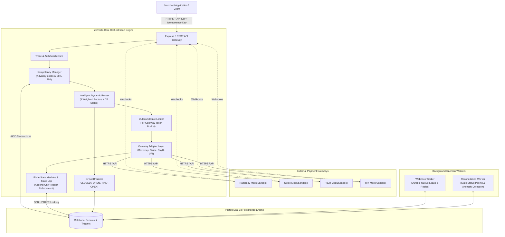
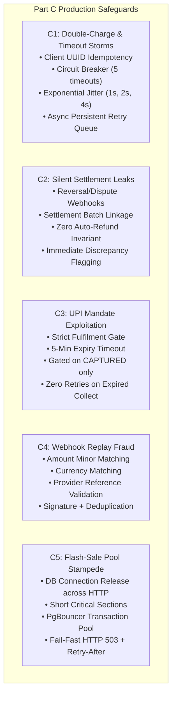
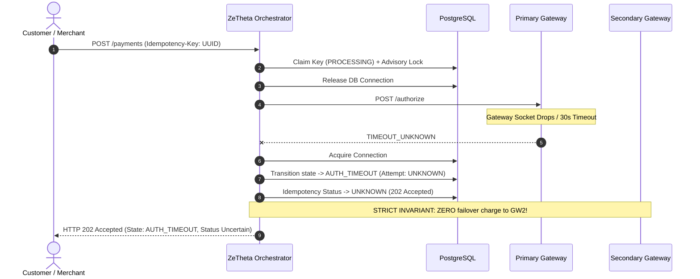
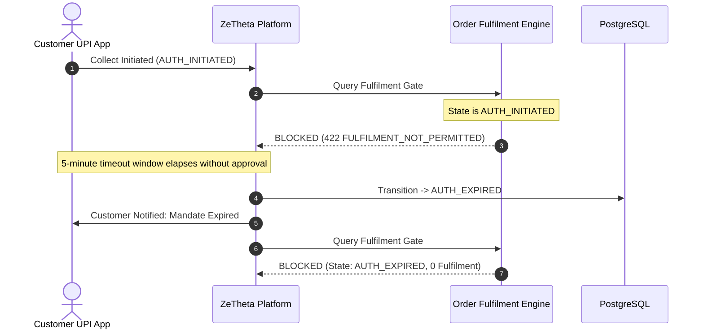

# System Architecture

## 1. Overview & High-Level Design

The **ZeTheta Payment Orchestration Platform** is an enterprise-grade multi-gateway transaction management engine built in TypeScript and backed by PostgreSQL 18. It provides unified payment collection, intelligent dynamic routing, deterministic state machine enforcement, automated zero-loss failover, reliable asynchronous webhook processing, and autonomous background reconciliation.

The system is designed strictly against **Part A: Training Material & Learning Resources (printed pages 3–23)** of `Zetheta_Backend_project.pdf`, adhering to the architectural directives of `Zetheta_Master_Implementation_Prompt.md` and the relational DDL specified in `Zetheta_Part_A_Complete_Database_Schema.md`.



---

## 2. End-to-End Payment Lifecycle Flow

```mermaid
sequenceDiagram
    autonumber
    actor Merchant as Merchant Client
    participant API as Express API
    participant Idem as Idempotency Mgr
    participant Router as Dynamic Router
    participant Breaker as Circuit Breaker
    participant Adapter as Gateway Adapter
    participant ExtGW as External Gateway
    participant DB as PostgreSQL
    participant Worker as Webhook / Recon Worker

    Merchant->>API: POST /api/v1/payments (Idempotency-Key, payload)
    API->>Idem: claimKey(key, payload_hash)
    Note over Idem,DB: Advisory lock acquired: pg_advisory_xact_lock
    alt Key already completed
        Idem-->>API: Return cached response (200/201)
        API-->>Merchant: Cached Payment Object
    else Key currently in-progress
        Idem-->>API: 409 Conflict (IDEMPOTENCY_IN_PROGRESS)
        API-->>Merchant: Error 409
    else Key novel
        Idem->>DB: INSERT INTO idempotency_keys (status='PROCESSING')
        API->>DB: INSERT INTO transactions (state='CREATED')
        API->>Router: selectRoute(paymentMethod, currency, amount)
        Router->>Breaker: Check health & states (CLOSED/HALF_OPEN/OPEN)
        Router->>DB: Calculate scores & INSERT INTO gateway_routes
        Router-->>API: Return Selected Gateway
        API->>DB: Transition state CREATED -> ROUTE_SELECTED -> AUTH_INITIATED
        API->>DB: INSERT INTO payment_attempts (attempt_no=1)
        Note over API,ExtGW: DB Transaction commits; gateway called outside DB lock
        API->>Adapter: authorize(payload)
        Adapter->>ExtGW: Dispatch gateway request
        alt Immediate Success (AUTHORISED / CAPTURED)
            ExtGW-->>Adapter: Success Reference
            Adapter-->>API: Status AUTHORISED
            API->>DB: Transition AUTH_INITIATED -> AUTHORISED
            API->>Breaker: recordSuccess()
            API->>Idem: completeKey(response)
            API-->>Merchant: 201 Created (Payment Object)
        else Definite Decline (HARD_DECLINE)
            ExtGW-->>Adapter: 402 Card Declined
            Adapter-->>API: HARD_DECLINE
            API->>DB: Transition AUTH_INITIATED -> AUTH_FAILED
            API-->>Merchant: 200/400 (Payment Object, state=AUTH_FAILED)
        else Transient Failure (TRANSIENT_FAILURE)
            ExtGW-->>Adapter: 503 Service Unavailable
            Adapter-->>API: TRANSIENT_FAILURE
            API->>DB: Mark attempt 1 FAILED
            API->>Breaker: recordFailure()
            Note over API,Router: Autonomous Safe Failover (< 2s)
            API->>Router: selectRoute(excludeGateways: [firstGateway])
            Router-->>API: Alternate Gateway (attempt_no=2)
            API->>Adapter: authorize(secondGateway)
            ExtGW-->>Adapter: Success
            API->>DB: Mark attempt 2 SUCCESS, state AUTHORISED
            API-->>Merchant: 201 Created
        else Network Timeout (TIMEOUT_UNKNOWN)
            ExtGW-->>Adapter: ETIMEDOUT (status uncertain)
            API->>DB: Transition AUTH_INITIATED -> AUTH_TIMEOUT
            API->>Idem: markUnknown()
            API-->>Merchant: 202 Accepted (State uncertain, queued for recon)
            Note over Worker,DB: Background Reconciliation Worker polls gateway & corrects state
        end
    end
```

---

## 3. Core Subsystems & Components

### 3.1 HTTP & API Layer
- **Framework:** Express 5 running with full TypeScript strict typing.
- **Middleware Pipeline:**
  1. `TraceMiddleware`: Attaches correlation IDs (`x-trace-id` / `traceId`) to every request, response, and structured log line.
  2. `AuthMiddleware`: Enforces header validation for `x-api-key`, discriminating between merchant operations (`x-api-key: test_api_key_zetheta_dev`) and administrative operations (`x-admin-key: admin_secret_key_zetheta`).
  3. `ErrorHandler`: Centralized RFC 7807 structured JSON error formatter preventing sensitive credential leakage while preserving traceable error codes and messages.

### 3.2 Idempotency Manager
- Canonical SHA-256 JSON hashing across deterministic key-sorted business payloads.
- PostgreSQL transactional advisory locks (`pg_advisory_xact_lock(hashtext(...))`) serialize concurrent attempts with identical keys before touching data rows.
- Atomic state lifecycle: `PROCESSING` -> `COMPLETED` | `FAILED` | `UNKNOWN`.
- Verified immune to multi-threaded race conditions (tested under 25 simultaneous concurrent requests).

### 3.3 Dynamic Routing Engine
- Multi-factor algorithmic ranking based on 5 parameters defined on PDF p. 10:
  1. Historical Success Rate ($w=0.35$)
  2. Gateway Processing Fee ($w=0.20$)
  3. Processing Latency ($w=0.20$)
  4. Gateway Health Metric ($w=0.15$)
  5. Merchant Commercial Priority ($w=0.10$)
- Normalization curves map fees and latencies such that lower costs and lower latencies yield higher fractional utility scores.
- Dynamic half-open traffic throttle: probes recovering gateways at a controlled 20% limit.

### 3.4 Outbound Rate Limiter
- In-memory token bucket and sliding window rate limiter scoped per gateway provider.
- Protects downstream payment gateway partner APIs from HTTP 429 throttling.

### 3.5 Circuit Breaker
- Per gateway and payment-method failure tracking.
- State progression: `CLOSED` -> 5 consecutive qualified errors -> `OPEN` -> 30-second cooldown -> `HALF_OPEN` -> 1 successful probe -> `CLOSED`.

### 3.6 Webhook Reliability Pipeline
- Raw-body HMAC-SHA256 signature verification (Razorpay `x-razorpay-signature`, Stripe `stripe-signature`, PayU hash, UPI HMAC).
- Immediate deduplication check against `processed_webhook_events`.
- Durable buffering via `webhook_queue` with exponential backoff (`next_delivery_at = NOW() + 2^attempt * 30s`) and Dead Letter Queue (`DLQ`) thresholding.

### 3.7 Background Reconciliation Engine
- Detects transactions lingering in uncertain states (`AUTH_TIMEOUT`, `CAPTURE_TIMEOUT`).
- Queries gateway status APIs to safely reconcile and transition states.
- Raises critical alarms on fatal financial discrepancies (e.g., internal `CAPTURED` vs gateway `FAILED`).


---

## 4. Part C — Real-World Failure Prevention

This section details the architectural defense mechanisms implemented across **Part C: Case Studies & Real-World Applications (printed pages 34–40)** of `Zetheta_Backend_project.pdf`.



---

### 4.1 C1 — Diwali Sale Double-Charge Prevention & Outbound Retries (pp. 34–35)

#### Incident Summary & Root Cause
During high-concurrency flash sales, downstream payment gateways experience timeout spikes under load. Naive checkout architectures that blindly retry timeouts cause catastrophic double-charging: the customer's account is debited at Gateway 1 while an uncoordinated failover creates a second debit at Gateway 2.

#### Applicable Design Patterns
1. **Deterministic Idempotency Key Preservation:** Client UUID is preserved across retries and enforced in database via composite unique indexes (`merchant_id`, `operation`, `key`).
2. **Circuit Breaker Fast-Failover:** Gateway circuit breaker trips `OPEN` after 5 consecutive timeouts, dynamically routing subsequent requests to healthy alternative gateways within 500ms.
3. **Bounded Exponential Backoff with Jitter:** Retries adhere to $1\text{s}, 2\text{s}, 4\text{s} \pm 25\%$ jitter to prevent thundering-herd synchronization.
4. **Persistent Asynchronous Retry Queue:** Retries are offloaded to `payment_retry_queue` processed via `FOR UPDATE SKIP LOCKED` background workers, preventing checkout thread blockage.
5. **No Double-Charge Rule on Ambiguous Timeouts:** On `TIMEOUT_UNKNOWN`, the transaction transitions to `AUTH_TIMEOUT` with idempotency status marked `UNKNOWN`, and NO failover attempt is made until reconciliation confirms the outcome.



- **Repository Modules:** `src/modules/payments/retry.service.ts`, `src/modules/idempotency/index.ts`, `src/database/repositories/circuit-breaker.repository.ts`, `src/modules/payments/payment.service.ts`.
- **Associated Part B Scenarios:** `FS-01` (primary timeout), `FS-03` (concurrent double-click), `FS-09` (multi-server duplicate).
- **Test Evidence:** `tests/case-studies/C1-double-charge-prevention.test.ts` (5/5 PASS).

---

### 4.2 C2 — Silent Settlement Leak Prevention & Reconciliation (p. 36)

#### Incident Summary & Root Cause
Internal order systems often assume funds are safely received once a transaction enters `CAPTURED`. However, post-capture reversals, chargebacks, and gateway settlement file exclusions result in silent revenue leakage if not continuously reconciled against authoritative settlement reports.

#### Applicable Design Patterns
1. **Comprehensive Event Lifecycle Ingestion:** Subscribes to and safely handles `payment.reversed`, `charge.refunded`, and `dispute.created` without illegal state transitions.
2. **Batch Membership Tracking:** Every captured transaction tracks explicit `settlement_status` (`PENDING`, `SETTLED`, `DISCREPANCY`) and links to `settlement_batches`.
3. **Zero Automatic Refund Invariant:** Discrepancies generate high-severity anomaly records in `reconciliation_anomalies` with `auto_refund_blocked: true`, requiring human investigation rather than speculative auto-refunds.

- **Repository Modules:** `src/modules/reconciliation/reconciliation.service.ts`, `src/modules/webhooks/webhook.service.ts`, `src/database/migrations/20261108000009_create_payment_retry_and_settlement_tables.ts`.
- **Associated Part B Scenarios:** `FS-11` (missing settlement file anomaly).
- **Test Evidence:** `tests/case-studies/C2-settlement-reconciliation.test.ts` (3/3 PASS).

---

### 4.3 C3 — UPI Mandate Exploitation Prevention & Fulfilment Gate (p. 37)

#### Incident Summary & Root Cause
In UPI collect requests, payments start in an asynchronous pending state (`AUTH_INITIATED`) waiting for customer app authorization. Attackers exploit naive systems that begin order dispatch upon collect initiation, walking away with goods while allowing the mandate to expire unpaid.

#### Applicable Design Patterns
1. **Strict Fulfilment Gating Invariant:** Order fulfilment is legally permitted *only* after `CAPTURED` or `SETTLED`. All calls to `FulfilmentGateService.canFulfil()` throw `FULFILMENT_NOT_PERMITTED` if the transaction is in `AUTH_INITIATED`, `AUTHORISED`, or `AUTH_EXPIRED`.
2. **Authoritative Expiration Window:** UPI collect mandates expire strictly after 5 minutes via `expirePayment()`, transitioning to `AUTH_EXPIRED`, notifying the customer via push/SMS, and permitting zero retries.
3. **Idempotent Fulfilment Notification:** Confirmed capture events emit `fulfilment.allowed` exactly once; duplicate notifications are suppressed.



- **Repository Modules:** `src/modules/fulfilment/fulfilment-gate.service.ts`, `src/modules/payments/payment.service.ts` (`expirePayment`).
- **Associated Part B Scenarios:** `FS-12` (UPI expiry customer notification).
- **Test Evidence:** `tests/case-studies/C3-upi-fulfilment-gate.test.ts` (3/3 PASS).

---

### 4.4 C4 — Webhook Replay Fraud Prevention (p. 38)

#### Incident Summary & Root Cause
Attackers obtain a validly signed webhook payload for a ₹10 transaction and replay it against an unrelated high-value ₹50,000 order. Because the HMAC signature is mathematically valid, systems that verify only cryptographic signatures mark the ₹50,000 order paid.

#### Applicable Design Patterns
1. **Deep Payload Semantic Validation:** Beyond raw HMAC verification, `WebhookService` validates:
   - **Amount Minor Match:** Incoming amount (converted to minor integer units) must exactly equal `transaction.amount_minor`.
   - **Currency Match:** Normalized payload currency must match `transaction.currency`.
   - **Provider Reference Match:** Gateway payment ID must correlate to the specific active attempt.
2. **Immediate Rejection & Security Audit:** Any discrepancy logs a `WEBHOOK_AMOUNT_MISMATCH` or `WEBHOOK_CURRENCY_MISMATCH` audit warning and halts state transition.
3. **Atomic Deduplication:** Uses `(gateway, event_id)` locking in `processed_webhook_events` to reject replay attempts without second effects.

- **Repository Modules:** `src/modules/webhooks/webhook.service.ts`, `src/api/controllers/webhook.controller.ts`.
- **Associated Part B Scenarios:** `FS-02` (duplicate webhook deduplication), `FS-10` (signature tamper rejection & source IP logging).
- **Test Evidence:** `tests/case-studies/C4-webhook-replay-fraud.test.ts` (3/3 PASS).

---

### 4.5 C5 — Flash-Sale Connection-Pool Stampede (pp. 39–40)

#### Incident Summary & Root Cause
Holding relational database connections open while awaiting external HTTP gateway responses causes connection pool starvation within seconds during traffic bursts. Blocked requests cascade into server deadlocks, recursive DB error logging, and total outage.

#### Applicable Design Patterns
1. **Connection Decoupling:** ZeTheta strictly enforces the **acquire/read/release → external gateway HTTP call → acquire/write/release** paradigm. No database client is checked out while waiting on gateway latency.
2. **Fail-Fast HTTP 503:** On pool exhaustion (`too_many_connections` or acquisition timeout), `error.middleware.ts` intercepts the exception and immediately returns `503 Service Unavailable` with `Retry-After: 5`, completely bypassing database logging.
3. **High-Performance Architecture:** Employs PgBouncer in transaction mode (`max_client_conn = 2000`) and read-replica segregation for heavy analytics queries.

- **Repository Modules:** `src/modules/payments/payment.service.ts`, `src/api/middleware/error.middleware.ts`, `src/database/connection.ts`, `docker-compose.yml`.
- **Associated Part B Scenarios:** `FS-14` (connection pool exhaustion & backpressure).
- **Test Evidence:** `tests/case-studies/C5-connection-pool-stampede.test.ts` (2/2 PASS).
