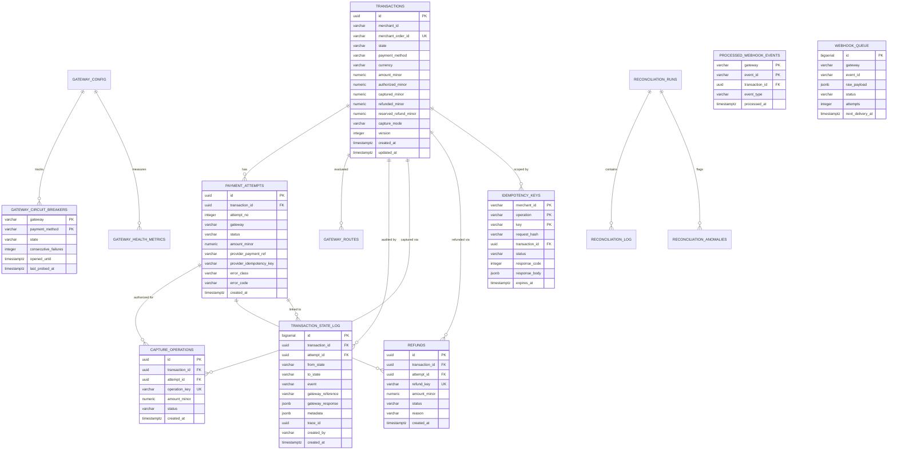

# Relational Data Model Specification

## 1. Entity-Relationship Overview

The ZeTheta platform persists financial transactions, routing audits, circuit breaker states, webhooks, and reconciliation records across a fully relational, 3NF schema in PostgreSQL.

---

## 2. Table Responsibilities & Schemas

### 2.1 `transactions`
- The core aggregate root representing a commercial customer payment order.
- Tracks monetary lifecycle balances in minor currency units (`authorized_minor`, `captured_minor`, `refunded_minor`, `reserved_refund_minor`).
- Guaranteed unique per `(merchant_id, merchant_order_id)`.
- Protected by optimistic locking column `version` and pessimistic row locks (`SELECT ... FOR UPDATE`).

### 2.2 `payment_attempts`
- Records every discrete interaction with a downstream payment gateway.
- Enforces composite uniqueness on `(transaction_id, attempt_no)`.
- Contains partial unique index guaranteeing at most **one active attempt per transaction** at any point in time.

### 2.3 `transaction_state_log`
- Append-only audit ledger of every state transition across the system.
- Captures `from_state`, `to_state`, triggering `event`, actor `created_by`, `trace_id`, and raw gateway responses.
- Protected by PostgreSQL trigger `trg_state_log_immutable` which prevents any modification or deletion.

### 2.4 `gateway_routes`
- Records real-time routing engine evaluations for each payment.
- Stores composite scores and factor breakdowns for all candidates, plus the winning gateway.

### 2.5 `capture_operations` & `refunds`
- Track individual partial/full capture and refund operations.
- Enforce idempotency via unique keys `operation_key` and `refund_key`.
- Foreign keys reference `(attempt_id, transaction_id)` to ensure referential integrity back to the authorized attempt.

### 2.6 `idempotency_keys`
- Stores request fingerprints (SHA-256) and cached HTTP responses.
- Composite primary key on `(merchant_id, operation, key)`.
- Lifecycle managed through PostgreSQL transactional advisory locks.

### 2.7 `gateway_circuit_breakers` & `gateway_health_metrics`
- Dynamic operational health indicators per gateway and payment instrument.
- Tracks consecutive failures, recovery cooldown timestamps, and 24-hour rolling success rates.

### 2.8 `processed_webhook_events` & `webhook_queue`
- Asynchronous webhook deduplication and durable retry buffer.
- Events verified by HMAC signature are registered in `processed_webhook_events` and enqueued in `webhook_queue`.
- Leased workers pop events with exponential backoff and dispatch them to the state machine.

### 2.9 `reconciliation_runs`, `reconciliation_log`, & `reconciliation_anomalies`
- Records automated batch reconciliation passes.
- Tracks examined transactions, corrected states, and flagged anomalies.

