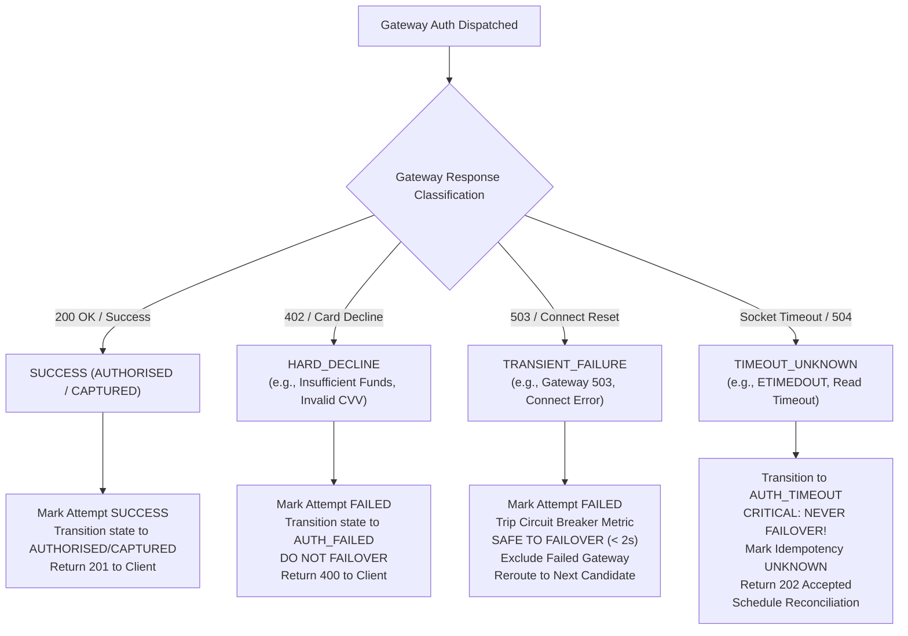

# Failover Safety & Double-Charge Prevention

## 1. The Double-Charge Risk in Payment Failovers

Automatic payment gateway failover is one of the most commercially valuable capabilities of a multi-gateway orchestrator, but it is also the most dangerous if misconfigured. In real-world payment networks, failing over after an **uncertain** response can cause catastrophic double charges to the customer.

The ZeTheta platform enforces strict mathematical and operational boundaries to ensure that failover occurs **only** when proven safe beyond any doubt.

---

## 2. Gateway Outcome Taxonomy & Failover Eligibility

When an authorization request is dispatched to a gateway adapter, the outcome is classified into one of four mutually exclusive categories:



### 2.1 Success (`AUTHORISED` / `CAPTURED`)
- Funds are confirmed held or settled.
- No failover required.

### 2.2 Hard Decline (`HARD_DECLINE`)
- Downstream gateway definitively rejected the payment due to instrument-level failure (insufficient balance, card expired, CVV error, stolen card).
- **Failover Rule: STRICTLY FORBIDDEN.** Rerouting to another gateway with the same payment instrument would produce the identical decline and waste processing fees. Transaction terminates in `AUTH_FAILED`.

### 2.3 Transient Failure (`TRANSIENT_FAILURE`)
- Downstream gateway rejected the connection before processing (HTTP 503 Service Unavailable, gateway connection reset, gateway maintenance window).
- The gateway has definitively confirmed that the transaction was **not** processed and no funds were captured.
- **Failover Rule: PERMITTED.** The router excludes the failed gateway (`excludeGateways: [firstGateway]`) and selects the next healthiest candidate.

### 2.4 Timeout / Uncertain (`TIMEOUT_UNKNOWN`)
- Downstream gateway socket timed out (`ETIMEDOUT`, HTTP 504 Gateway Timeout) after the request was transmitted, but before a response was received.
- **The state of the customer's funds is UNKNOWN.** The gateway may have successfully authorized the payment, or it may have aborted.
- **Failover Rule: ABSOLUTELY PROHIBITED.** If ZeTheta were to dispatch this payment to a second gateway, both gateways might debit the customer, resulting in a **double charge**.
- **Remediation:** Transaction transitions to `AUTH_TIMEOUT`, idempotency key is set to `UNKNOWN`, HTTP 202 Accepted is returned to the client, and the transaction is queued for autonomous background reconciliation.

---

## 3. The 2-Second Failover Execution Budget

For eligible transient failures, the failover process completes within a strict 2-second SLA:

| Stage | Duration Budget | Operational Action |
|---|---|---|
| Primary Dispatch | $\le 1200\text{ ms}$ | First gateway returns HTTP 503 or disconnect. |
| Failure Evaluation | $\le 50\text{ ms}$ | Attempt marked `FAILED`, circuit breaker failure recorded. |
| Dynamic Reroute | $\le 50\text{ ms}$ | Router recalculates candidate utility scores excluding the failed gateway. |
| Secondary Dispatch | $\le 650\text{ ms}$ | Alternate gateway successfully authorizes the payment. |
| **Total Response Time** | $\mathbf{\le 1950\text{ ms}}$ | Seamless HTTP 201 Created returned to client without user disruption. |

---

## 4. Single-Active-Attempt Enforced by Database Constraint

To prevent code-level race conditions or concurrent threads from attempting multiple gateways simultaneously, the database schema enforces a partial unique index on `payment_attempts`:

```sql
CREATE UNIQUE INDEX idx_single_active_attempt_per_tx
    ON payment_attempts (transaction_id)
    WHERE status IN ('INITIATED', 'PENDING');
```

If any background thread attempts to initiate a secondary attempt while attempt 1 is still in `INITIATED` status, PostgreSQL immediately rejects the query with a unique constraint violation, guaranteeing sequential safety.

