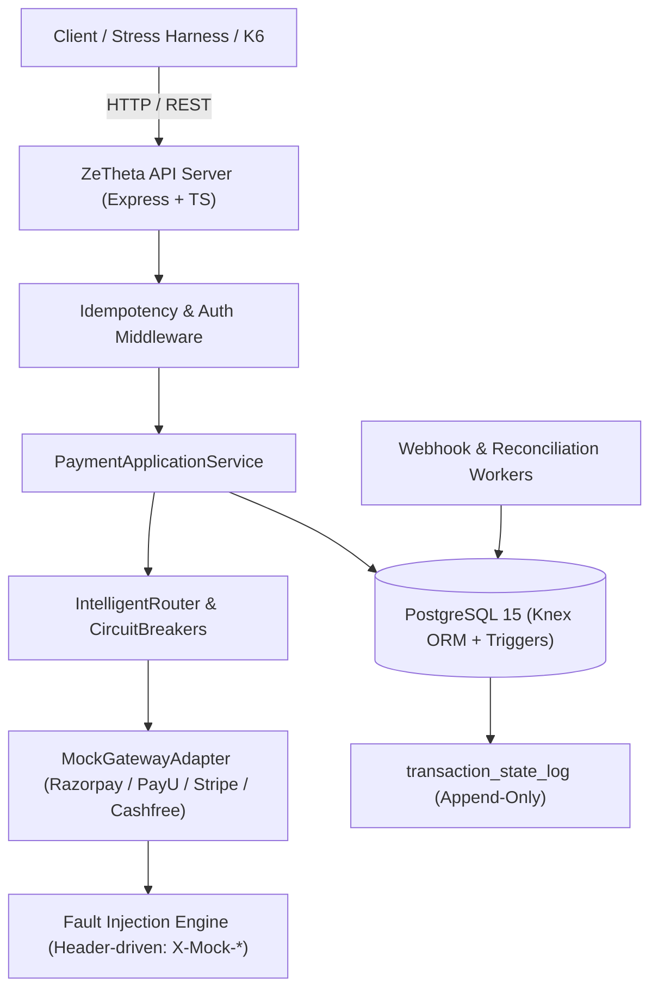
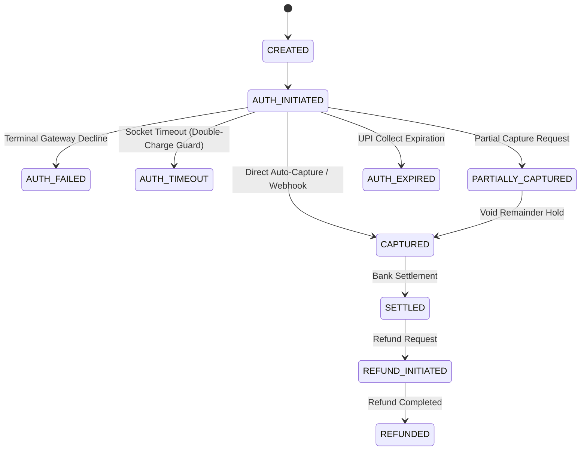

# Part B: Gamified Simulation Engine — Architecture & Design

## 1. System Overview

The **ZeTheta Gamified Simulation Engine** (Part B) extends the core payment orchestration platform (Part A) with deterministic fault injection, chaotic gateway emulation, high-concurrency stress testing, and real-time automated audit verification.

The simulation layer sits between the application service boundary and mock gateway adapters, allowing automated test harnesses, benchmark suites, and operators to simulate real-world financial failure scenarios without risking production funds or requiring external bank sandbox infrastructure.

---

## 2. Deterministic Mock Gateway Architecture

Each gateway adapter (`RazorpayGatewayAdapter`, `PayUGatewayAdapter`, `StripeGatewayAdapter`, `CashfreeGatewayAdapter`) implements a shared fault-injection contract evaluated at invocation time.

### 2.1 Fault Injection Control Headers

Simulation behaviors are triggered dynamically using deterministic request headers or adapter configurations:

| Header / Config | Type | Description |
|---|---|---|
| `X-Mock-Response` | string | Forces an explicit outcome: `TIMEOUT`, `SERVER_ERROR`, `SUCCESS`, `DECLINED`, `RATE_LIMIT` |
| `X-Mock-Delay-Ms` | integer | Injects artificial socket latency in milliseconds before responding |
| `X-Mock-Gateway-Down` | boolean | Forces immediate TCP connection drop or gateway unreachable exception |
| `Retry-After` | integer | Injected on HTTP 429/503 responses to signal backoff duration |

### 2.2 Latency and State Management

- **Zero Unintended Latency**: By default (`X-Mock-Delay-Ms: 0`), mock gateways execute synchronously in memory within < 5ms to enable ultra-high-throughput benchmarking (> 200 req/s).
- **Socket Timeouts**: When `X-Mock-Response: TIMEOUT` is specified, the gateway adapter throws a `GatewayTimeoutException` after simulating the configured socket timeout threshold (e.g. 5000ms in production, parameterized to 50ms in fast-test mode).

---

## 3. Financial State Machine & Transition Rules

The Part B simulation operates under the strictly enforced Part A state machine, guarded by the immutable PostgreSQL trigger `trg_state_log_immutable`.

### Critical Invariants

1. **Double-Charge Failover Guard (FS-01)**:
   - On `TIMEOUT_UNKNOWN`, the transaction transitions to `AUTH_TIMEOUT`. Failover to an alternate gateway is strictly **prohibited** because downstream funds may have already been debited.
   - Failover is permitted **only** on verified `TRANSIENT_FAILURE` (HTTP 503) where downstream gateway confirms no charge was created.
2. **Method-Fit Routing (FS-07)**:
   - When cascading through fallback gateways, routing constraints are strictly preserved. E.g., UPI transactions can never fall back to Stripe (cards only).
3. **Audit Ledger Immutability**:
   - `transaction_state_log` rejects all `UPDATE` and `DELETE` commands at the database engine level via PostgreSQL triggers.

---

## 4. Multi-Tenant Idempotency Engine (FS-09, FS-13)

Idempotency is isolated across merchants using a composite primary key:
$$\text{PK} = (\text{merchant\_id}, \text{operation}, \text{key})$$

1. **Concurrent Request Race (FS-09)**:
   - 5 simultaneous identical requests for the same merchant and key hit PostgreSQL.
   - Exactly 1 acquires the atomic reservation lock via `INSERT ... ON CONFLICT DO NOTHING`.
   - The remaining 4 requests receive HTTP 409 Conflict (or poll until resolution) without duplicating state.
2. **Multi-Tenant Key Collision (FS-13)**:
   - Merchant A and Merchant B can simultaneously use the identical UUID idempotency key without collisions or interference.

---

## 5. Webhook & Reconciliation Subsystems (FS-02, FS-06, FS-10, FS-11)

### 5.1 Out-of-Order Webhooks (FS-06)
When a webhook arrives before the synchronous API call completes, the webhook worker acquires a row-level lock (`SELECT ... FOR UPDATE`), promotes the payment to `CAPTURED`, and records `OUT_OF_ORDER_RESOLUTION`. When the synchronous caller completes, it detects the existing `CAPTURED` state and returns cleanly without rolling back.

### 5.2 Signature Tampering Guard (FS-10)
Webhooks with invalid or forged HMAC signatures are immediately rejected with HTTP 401 `WEBHOOK_SIGNATURE_INVALID`, leaving the transaction state unchanged and writing an audit alert.

### 5.3 Missing Settlement Reconciliation (FS-11)
Reconciliation scans identify internal `CAPTURED` payments that are missing from bank settlement batches. Instead of triggering dangerous automatic refunds, the reconciler transitions the status to `RECONCILIATION_MISMATCH` and files an anomaly investigation audit log.

---

## 6. Circuit Breaker & Resiliency Coordination

Gateways are wrapped in three-state circuit breakers (`CLOSED`, `OPEN`, `HALF_OPEN`):

- **Failure Threshold**: 5 consecutive errors open the circuit.
- **Cool-off Duration**: 30 seconds before transitioning to `HALF_OPEN`.
- **Router Exclusion**: Gateways in the `OPEN` state are automatically excluded from the routing candidate set during route evaluation (`IntelligentRouter.selectRoute`).
- **Method-Fit Validation**: Excluded gateways do not force cross-payment-method violations. If all compliant gateways are down, the router fails gracefully with `NO_SUITABLE_GATEWAY`.

