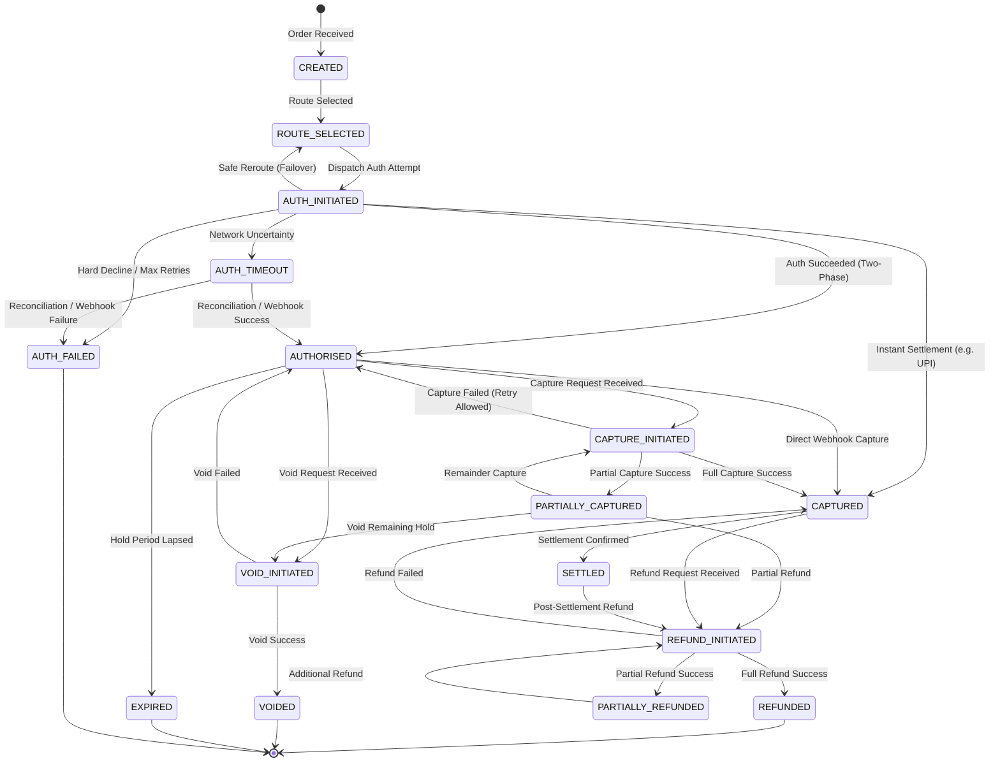

# Transaction State Machine Specification

## 1. State Machine Overview

The transaction lifecycle within the ZeTheta Payment Orchestration Platform is governed by a deterministic, mathematically rigorous Finite State Machine (FSM). State mutations are strictly validated prior to persistence, and all historical transitions are captured in an append-only audit trail enforced by PostgreSQL database triggers.



---

## 2. Formal State Definitions

| State | Category | Description |
|---|---|---|
| `CREATED` | Initial | Transaction record created; routing and attempt processing not yet begun. |
| `ROUTE_SELECTED` | Intermediate | Intelligent router has scored candidates and selected optimal gateway. |
| `AUTH_INITIATED` | Active | Authorization payload dispatched to downstream gateway adapter. |
| `AUTHORISED` | Terminal Hold | Funds held on customer instrument; ready for capture or void. |
| `AUTH_FAILED` | Terminal Failure | Authorization definitively declined or all retry attempts exhausted. |
| `AUTH_TIMEOUT` | Uncertain | Gateway did not respond within timeout window; awaiting reconciliation. |
| `CAPTURE_INITIATED`| Active | Capture instruction dispatched to downstream gateway. |
| `CAPTURED` | Terminal Settlement | Full authorized funds captured successfully into merchant account. |
| `PARTIALLY_CAPTURED`| Intermediate | Portion of authorized hold captured; remainder still on hold. |
| `VOID_INITIATED` | Active | Cancellation of authorized hold dispatched to downstream gateway. |
| `VOIDED` | Terminal Release | Authorized hold successfully released back to customer instrument. |
| `REFUND_INITIATED` | Active | Refund instruction dispatched to downstream gateway. |
| `REFUNDED` | Terminal Refund | Full captured funds returned to customer. |
| `PARTIALLY_REFUNDED`| Intermediate | Portion of captured funds refunded; remainder retained. |
| `SETTLED` | Settled | Batch settlement finalized by payment partner. |
| `EXPIRED` | Terminal Timeout | Hold authorization lapsed without capture or void before deadline. |

---

## 3. Permitted Transition Matrix

| From State | Event | To State | Trigger / Conditions |
|---|---|---|---|
| `CREATED` | `ROUTE_SELECT` | `ROUTE_SELECTED` | Router scores candidates and selects gateway. |
| `ROUTE_SELECTED` | `BEGIN_AUTH` | `AUTH_INITIATED` | Payment attempt created and dispatched to gateway. |
| `AUTH_INITIATED` | `AUTH_SUCCESS` | `AUTHORISED` | Two-phase gateway returns authorized hold. |
| `AUTH_INITIATED` | `CAPTURE_COMPLETE` | `CAPTURED` | Instant-settlement payment (UPI) or direct auto-capture. |
| `AUTH_INITIATED` | `AUTH_DECLINE` | `AUTH_FAILED` | Definite card decline (e.g. invalid CVV, insufficient funds). |
| `AUTH_INITIATED` | `AUTH_TIMEOUT` | `AUTH_TIMEOUT` | Network timeout or gateway 504; outcome unverified. |
| `AUTH_INITIATED` | `SAFE_REROUTE` | `ROUTE_SELECTED` | Transient error qualifies for zero-loss reroute (< 2s). |
| `AUTH_TIMEOUT` | `RECON_SUCCESS` | `AUTHORISED` | Reconciliation discovers gateway successfully held funds. |
| `AUTH_TIMEOUT` | `RECON_FAIL` | `AUTH_FAILED` | Reconciliation confirms gateway did not record transaction. |
| `AUTHORISED` | `BEGIN_CAPTURE` | `CAPTURE_INITIATED` | Merchant API capture request received. |
| `AUTHORISED` | `CAPTURE_COMPLETE` | `CAPTURED` | Asynchronous gateway webhook confirms capture. |
| `AUTHORISED` | `BEGIN_VOID` | `VOID_INITIATED` | Merchant API void request received. |
| `AUTHORISED` | `HOLD_EXPIRED` | `EXPIRED` | Hold window expires without capture or void. |
| `CAPTURE_INITIATED`| `CAPTURE_COMPLETE` | `CAPTURED` | Gateway confirms full capture. |
| `CAPTURE_INITIATED`| `PARTIAL_CAPTURE` | `PARTIALLY_CAPTURED`| Gateway confirms partial capture; `captured < authorized`. |
| `CAPTURE_INITIATED`| `CAPTURE_ERROR` | `AUTHORISED` | Gateway capture error; hold remains valid for retry. |
| `PARTIALLY_CAPTURED`| `BEGIN_CAPTURE` | `CAPTURE_INITIATED` | Merchant requests remainder or additional partial capture. |
| `PARTIALLY_CAPTURED`| `BEGIN_REFUND` | `REFUND_INITIATED` | Merchant initiates refund on captured portion. |
| `PARTIALLY_CAPTURED`| `BEGIN_VOID` | `VOID_INITIATED` | Merchant releases remainder of uncaptured hold. |
| `CAPTURED` | `BEGIN_REFUND` | `REFUND_INITIATED` | Merchant initiates refund request. |
| `CAPTURED` | `SETTLE` | `SETTLED` | Gateway batch payout confirmed. |
| `VOID_INITIATED` | `VOID_SUCCESS` | `VOIDED` | Gateway confirms void release. |
| `VOID_INITIATED` | `VOID_ERROR` | `AUTHORISED` | Void failed; hold remains in authorized state. |
| `REFUND_INITIATED` | `REFUND_COMPLETE` | `REFUNDED` | Full captured amount refunded (`refunded == captured`). |
| `REFUND_INITIATED` | `PARTIAL_REFUND` | `PARTIALLY_REFUNDED`| Partial refund processed (`refunded < captured`). |
| `REFUND_INITIATED` | `REFUND_ERROR` | `CAPTURED` | Refund rejected by gateway; funds remain captured. |
| `PARTIALLY_REFUNDED`| `BEGIN_REFUND` | `REFUND_INITIATED` | Additional refund requested. |
| `SETTLED` | `BEGIN_REFUND` | `REFUND_INITIATED` | Post-settlement refund request dispatched. |

---

## 4. Invariants & Database Trigger Protection

### 4.1 Invariant Rules
1. **Sum of Captures Invariant:**
   $$\text{captured\_minor} \le \text{authorized\_minor}$$
   Enforced via SQL `CHECK (captured_minor <= authorized_minor)` and locked via `SELECT ... FOR UPDATE`.
2. **Sum of Refunds Invariant:**
   $$\text{refunded\_minor} + \text{reserved\_refund\_minor} \le \text{captured\_minor}$$
   Prevents refund amounts from exceeding captured merchant funds.
3. **No Double-Spend / Single State Lock:**
   State transitions are executed within PostgreSQL transactions under `SELECT ... FOR UPDATE` row locks, preventing race conditions.

### 4.2 Append-Only Immutability Trigger
The audit table `transaction_state_log` is protected by trigger `trg_state_log_immutable`:
```sql
CREATE OR REPLACE FUNCTION forbid_audit_mutation()
RETURNS TRIGGER AS $$
BEGIN
    RAISE EXCEPTION 'CANNOT_MUTATE_AUDIT_LOG: Records in % are append-only and cannot be updated or deleted.',
        TG_TABLE_NAME;
END;
$$ LANGUAGE plpgsql;

CREATE TRIGGER trg_state_log_immutable
    BEFORE UPDATE OR DELETE ON transaction_state_log
    FOR EACH ROW
    EXECUTE FUNCTION forbid_audit_mutation();
```
Any `UPDATE` or `DELETE` statement issued against `transaction_state_log` immediately aborts with SQLSTATE exception, guaranteeing compliance and forensic integrity.

